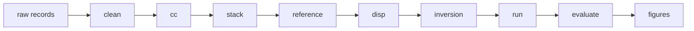
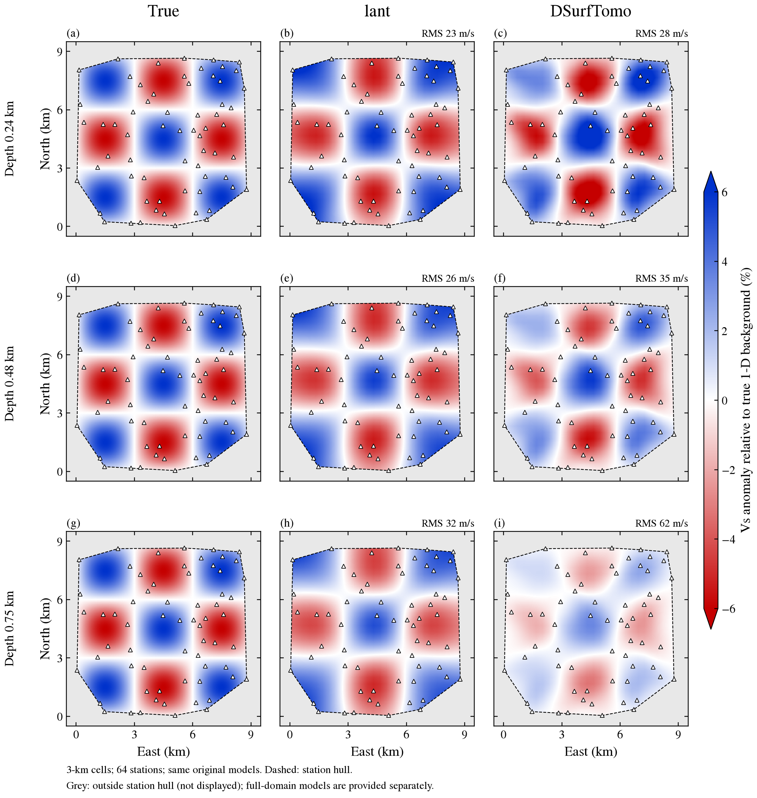
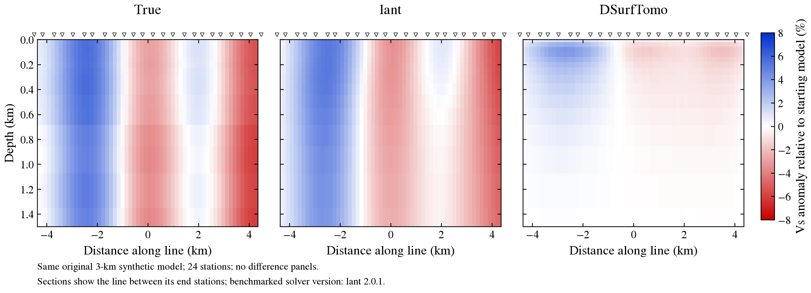
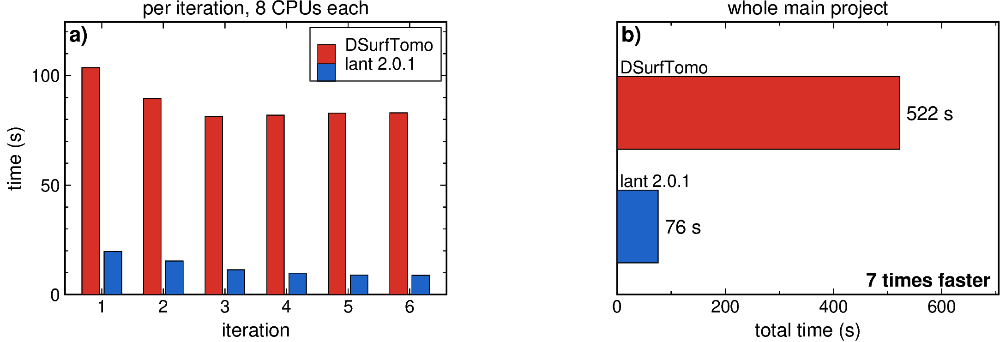

# local_ANT

**Ambient-noise surface-wave tomography for dense nodal arrays, from raw records to a 3-D shear-velocity model.**

[](https://github.com/Shubin-Wei/local_ANT/actions/workflows/tests.yml)
[](https://github.com/Shubin-Wei/local_ANT/releases)
[](pyproject.toml)
[](LICENSE)

[中文](README.zh.md) | English

## Overview

lant is a command-line workflow for high-frequency ambient-noise tomography with dense arrays (areal arrays and lines). It takes raw continuous records in any directory layout and any format ObsPy reads, and returns a 3-D Vs model with its dispersion data, resolution tests and a report.

- **Three inputs.** A raw-data directory, a station table and an output directory. Every other parameter has a documented default or is derived from the data by a written rule; each step report shows the derivation with the numbers of your data.
- **Decisions stay with the user.** The chain stops only where a scientific judgement is needed (for example, whether the picked ridge is the fundamental mode), shows what to look at, and records the decision with its reason.
- **Published methods and engineering choices.** Core methods are linked with their conditions of validity. Numerical thresholds, automatic rules and display choices also contain empirical engineering decisions; citations do not establish every default.
- **Traceable and resumable.** Each step records its inputs, parameters, code version and outputs; a changed parameter marks the affected steps as stale; an interrupted run continues where it stopped.
- **Readable results.** `REPORT.md` gives the state of every step, key numbers, the items to judge and the main figures; `results/` holds the model as a table, the dispersion data, figures and validation.

## Workflow



| Step | Purpose | Method |
|---|---|---|
| `clean` | Reads the records, matches them to the station table, cuts processing days, removes instrument responses when response files are given, tests for a 1-s timing pulse | Bensen et al. (2007); Takagi et al. (2015) |
| `cc` | Hourly cross-coherence of the vertical components | Xu et al. (2021) |
| `stack` | Stack and sub-stacks; station diagnosis by leave-one-out correlation and time shift | Stehly et al. (2007); Sens-Schönfelder (2008) |
| `reference` | Reference phase-velocity curve of the array from its frequency–Bessel spectrum | Wang et al. (2019) |
| `disp` | Two-station phase velocities with phase-matched filtering, jackknife errors and quality control | Yao et al. (2006); Levshin & Ritzwoller (2001); Bensen et al. (2007) |
| `inversion`, `run` | 1-D starting model; direct inversion of travel times for 3-D Vs (DSurfTomo's method ported to Python, with lant's regularization, rejection and solve) | Fang et al. (2015); [methods](docs/methods.md) 8.3–8.4 |
| `evaluate`, `figures` | Residuals, checkerboard recovery and control inversions; maps, sections and dispersion figures | Lévêque et al. (1993); Rawlinson & Spakman (2016) |

## Installation

Requirements: Linux, conda (or mamba) and git. lant is installed from this repository; it is not on PyPI, where `lant` is an unrelated package.

```bash
git clone https://github.com/Shubin-Wei/local_ANT.git && cd local_ANT
conda env create -f environment.yml && conda activate lant   # Python, ObsPy, GMT 6 and lant
lant check                                                   # reports anything missing and how to install it
```

## Quick start

On your data:

```bash
lant init -o /data/result/config.yaml --raw /data/raw --stations /data/stations.csv --out /data/result
# Edit the common settings in config.yaml before running.
lant validate -c /data/result/config.yaml
lant plan cc -c /data/result/config.yaml
lant run all -c /data/result/config.yaml
```

The configuration stays editable; each execution records the values it actually used. When the chain stops for a judgement it prints the evidence and next command:

```bash
lant status -c /data/result/config.yaml        # state of every step and the next command
lant confirm reference -c /data/result/config.yaml --reason "picks follow the fundamental ridge in 3_fj_phase_velocity.png"
lant run all -c /data/result/config.yaml       # continues from the first step that does not stand
```

`lant plan -c CONFIG` shows what every step will do, and with which values, before anything runs. The [quick start guide](docs/quickstart.md) walks through a first project.

## Output

```text
/data/result/
├── REPORT.md     state, key numbers, items to judge, main figures
├── results/      model/vs_model.csv, dispersion/curves.csv, figures/, validation/, parameters.yaml
├── work/         processing files of every step (kept: rerun and redraw without recomputing)
├── .lant/        state, step reports, configuration history, provenance, logs
└── notes.md      your notes and decisions
```

Every file is described in [docs/outputs.md](docs/outputs.md).

## Tests against a known model

A synthetic test at the inversion level ([docs/validation.md](docs/validation.md)): travel times of a known model, a ±6 % checkerboard of 3-km cells on a 1-D background, are computed for a station layout, Gaussian noise of 2.5 % of the period is added, and lant and the original DSurfTomo invert the same input files on the same 8 CPUs. Each uses its own regularization and rejection (lant: weight 1; DSurfTomo: weight 1, damping 1).

| test | inversion | rms error vs truth (start 88.5 / 82.0 m/s) | recovered fraction of the anomaly | time, 8 CPUs |
|---|---|---:|---:|---:|
| areal array, 64 stations | **lant** | **31.4 m/s** | 0.82 | **76 s** |
| | DSurfTomo | 60.0 m/s | 0.44 | 522 s |
| line, 24 stations | **lant** | **15.3 m/s** | 0.91 | **72 s** |
| | DSurfTomo | 65.5 m/s | 0.25 | 1522 s |

The test inverts exact travel times with noise; it does not test the measurement of the dispersion, and real data, with measurement and theory errors, can be expected to recover less.



<sub>Areal array, 64 stations (triangles), 16 223 travel times. Columns: True, lant, DSurfTomo, using the original 3-km cells. Grey masks the area outside the station hull in all three panels; the hull is the scoring/display boundary, not a resolution guarantee. The unmasked models and outside-hull diagnostics are in [validation](docs/validation.md).</sub>



<sub>Line, 24 stations (inverted triangles), 3 143 travel times: Vs anomaly along the line between its end stations, in True / lant / DSurfTomo order.</sub>



<sub>Areal array: time of each of the 6 iterations and of the whole main project, both pinned to the same 8 CPUs.</sub>

## Scope and limitations

- Vertical components only (ZZ, fundamental-mode Rayleigh waves); areal arrays and lines (one project per line).
- The noise field is assumed to be close to isotropic; the bias from directional noise is not tested.
- Linux only. Station coordinates in longitude and latitude; arrays across the date line or beyond 80° latitude are refused.
- At most 60 periods in the 3-D inversion (DSurfTomo's CalSurfG). Station coordinates are single precision, as in DSurfTomo (about 0.4 m); observed and predicted travel times share them, and on the test projects the distances of the pairs that reach the inversion (0.5 km and longer: the wavelength rule removes shorter ones) differ from double precision by at most 0.2 %.
- Without response files all stations must be of one instrument model; tolerances within a model leave random phase errors of 0.1–1 % of the travel time.
- The numbers of the synthetic tests are in [docs/validation.md](docs/validation.md).

Everything runs in Python: the inversion is a port of DSurfTomo whose forward part (fast marching, rays, phase velocities) matches the original, with lant's own regularization, rejection and least-squares solve since 2.0.1; the comparison with the original and every departure from it are in [docs/python_backends.md](docs/python_backends.md).

## Documentation

| Document | Contents |
|---|---|
| [Quick start](docs/quickstart.md) | Installation, your own data, where the chain stops for you |
| [Tutorial](docs/tutorial.md) | Data preparation and every step: purpose, procedure, parameters, what to check |
| [Methods](docs/methods.md) | Principles, formulas, sources and conditions of validity |
| [Parameters](docs/parameters.md) | Every configuration key: default, meaning, basis |
| [Output files](docs/outputs.md) | What every output file holds and when to look at it |
| [Troubleshooting](docs/troubleshooting.md) | Common problems and remedies, step by step |
| [Validation](docs/validation.md) | Synthetic tests and their numbers |
| [AI assistants](docs/ai_workflow.md) | Running the chain with an AI assistant |
| [History](docs/history.md) | Changes between versions |
| [Contributing](CONTRIBUTING.md) | Reporting problems, development rules and checks |

## Citation

Please cite the methods the workflow rests on (table above; full references in [docs/parameters.md](docs/parameters.md)), DSurfTomo (Fang et al. 2015, *Geophys. J. Int.* 201, 1251–1263) and the methods its port follows (among them Herrmann's surf96, Herrmann 2013), as well as ObsPy and GMT. Citation metadata for this software are in [CITATION.cff](CITATION.cff).

## License

MIT, see [LICENSE](LICENSE). The inversion modules `lant/inversion/dsurf_*.py` are ported from DSurfTomo (MIT, Fang et al. 2015).
