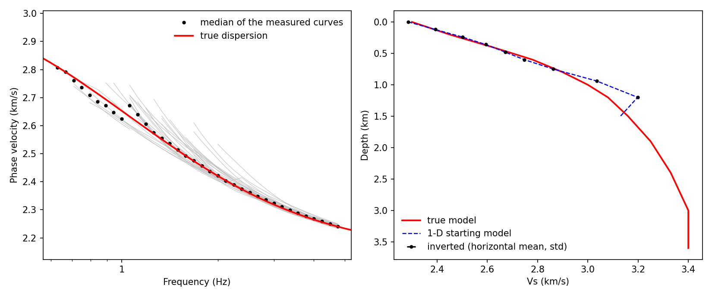
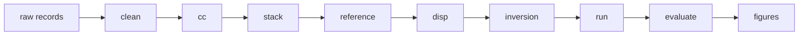

# local_ANT

**Ambient-noise surface-wave tomography for dense nodal arrays, from raw records to a 3-D shear-velocity model.**

[](https://github.com/Shubin-Wei/local_ANT/actions/workflows/tests.yml)
[](https://github.com/Shubin-Wei/local_ANT/releases)
[](pyproject.toml)
[](LICENSE)

[中文](README.zh.md) | English



<sub>**Synthetic test with a known answer** (laterally uniform medium): measured phase velocities and their median against the true dispersion (left); true model, 1-D starting model and horizontally averaged inverted Vs (right). It illustrates the workflow and its output, not the general 3-D resolution.</sub>

## Overview

lant is a command-line workflow for high-frequency ambient-noise tomography with dense arrays (areal arrays and lines). It takes raw continuous records in any directory layout and any format ObsPy reads, and returns a 3-D Vs model with its dispersion data, resolution tests and a report.

- **Three inputs.** A raw-data directory, a station table and an output directory. Every other parameter has a documented default or is derived from the data by a written rule; each step report shows the derivation with the numbers of your data.
- **Decisions stay with the user.** The chain stops only where a scientific judgement is needed (for example, whether the picked ridge is the fundamental mode), shows what to look at, and records the decision with its reason.
- **Methods with sources.** Every step follows published methods, listed with their conditions of validity; defaults without a source are marked as empirical.
- **Traceable and resumable.** Each step records its inputs, parameters, code version and outputs; a changed parameter marks the affected steps as stale; an interrupted run continues where it stopped.
- **Readable results.** `REPORT.md` gives the state of every step, key numbers, the items to judge and the main figures; `results/` holds the model as a table, the dispersion data, figures and validation.

## Workflow



| Step | Purpose | Method |
|---|---|---|
| `clean` | Reads the records, matches them to the station table, cuts processing days, removes instrument responses when response files are given, tests for a 1-s timing pulse | Bensen et al. (2007); Takagi et al. (2015) |
| `cc` | Hourly cross-coherence of the vertical components | Xu et al. (2021) |
| `stack` | Stack and sub-stacks; station diagnosis by leave-one-out correlation and time shift | Stehly et al. (2007); Sens-Schönfelder (2008) |
| `reference` | Reference phase-velocity curve of the array from its frequency–Bessel spectrum | Wang et al. (2019) |
| `disp` | Two-station phase velocities with phase-matched filtering, jackknife errors and quality control | Yao et al. (2006); Levshin & Ritzwoller (2001); Bensen et al. (2007) |
| `inversion`, `run` | 1-D starting model; direct inversion of travel times for 3-D Vs with DSurfTomo or pDSurfTomo | Fang et al. (2015) |
| `evaluate`, `figures` | Residuals, checkerboard recovery and control inversions; maps, sections and dispersion figures | Lévêque et al. (1993); Rawlinson & Spakman (2016) |

## Installation

Requirements: Linux, conda (or mamba) and git. lant is installed from this repository; it is not on PyPI, where `lant` is an unrelated package.

```bash
git clone https://github.com/Shubin-Wei/local_ANT.git && cd local_ANT
conda env create -f environment.yml && conda activate lant   # Python, ObsPy, GMT 6, compilers and lant
lant install-external                                        # builds DSurfTomo and pDSurfTomo (fixed versions)
lant check                                                   # reports anything missing and how to install it
```

## Quick start

Run the whole chain on a synthetic array with a known answer (a few minutes):

```bash
lant demo --out ~/lant_demo
```

Then on your own data:

```bash
lant run all --raw /data/raw --stations /data/stations.csv --out /data/result
```

This writes `/data/result/config.yaml` and starts the chain. When it stops for a judgement it prints the files to look at and the next command:

```bash
lant status -c /data/result/config.yaml        # state of every step and the next command
lant confirm reference -c /data/result/config.yaml --reason "picks follow the fundamental ridge in fj.png"
lant run all -c /data/result/config.yaml       # continues from the first step that does not stand
```

`lant plan -c CONFIG` shows what every step will do, and with which values, before anything runs. The [quick start guide](docs/quickstart.md) walks through a first project.

## Output

```text
/data/result/
├── REPORT.md     state, key numbers, items to judge, main figures
├── results/      model/vs_model.csv, dispersion/, figures/, validation/, reproduce/
├── work/         processing files of every step
├── .lant/        state, step reports, configuration history, provenance, logs
└── notes.md      your notes and decisions
```

Every file is described in [docs/outputs.md](docs/outputs.md).

## Scope and limitations

- Vertical components only (ZZ, fundamental-mode Rayleigh waves); areal arrays and lines (one project per line).
- The noise field is assumed to be close to isotropic; the bias from directional noise is not tested.
- Linux only. Station coordinates in longitude and latitude; arrays across the date line or beyond 80° latitude are refused.
- DSurfTomo accepts at most 60 periods (pDSurfTomo 80); pairs closer than about 200 m carry distance errors from its single-precision coordinates.
- Without response files all stations must be of one instrument model; tolerances within a model leave random phase errors of 0.1–1 % of the travel time.
- The numbers of the synthetic tests are in [docs/validation.md](docs/validation.md).

## Documentation

| Document | Contents |
|---|---|
| [Quick start](docs/quickstart.md) | Installation, a first run on synthetic data, your own data |
| [Tutorial](docs/tutorial.md) | Data preparation and every step: purpose, procedure, parameters, what to check |
| [Methods](docs/methods.md) | Principles, formulas, sources and conditions of validity |
| [Parameters](docs/parameters.md) | Every configuration key: default, meaning, basis |
| [Output files](docs/outputs.md) | What every output file holds and when to look at it |
| [Troubleshooting](docs/troubleshooting.md) | Common problems and remedies, step by step |
| [Validation](docs/validation.md) | Synthetic tests and their numbers |
| [AI assistants](docs/ai_workflow.md) | Running the chain with an AI assistant |
| [History](docs/history.md) | Changes between versions |
| [Contributing](CONTRIBUTING.md) | Reporting problems, development rules and checks |

## Citation

Please cite the methods the workflow rests on (table above; full references in [docs/parameters.md](docs/parameters.md)), DSurfTomo (Fang et al. 2015, *Geophys. J. Int.* 201, 1251–1263) and, when used, pDSurfTomo (Zhu et al. 2026, arXiv:2604.11920), as well as ObsPy and GMT. Citation metadata for this software are in [CITATION.cff](CITATION.cff).

## License

MIT, see [LICENSE](LICENSE). DSurfTomo (MIT) and pDSurfTomo (GPL-3) are downloaded and built by `lant install-external` under their own licences and are not part of this repository.
