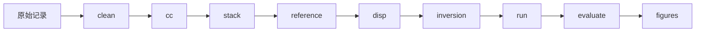
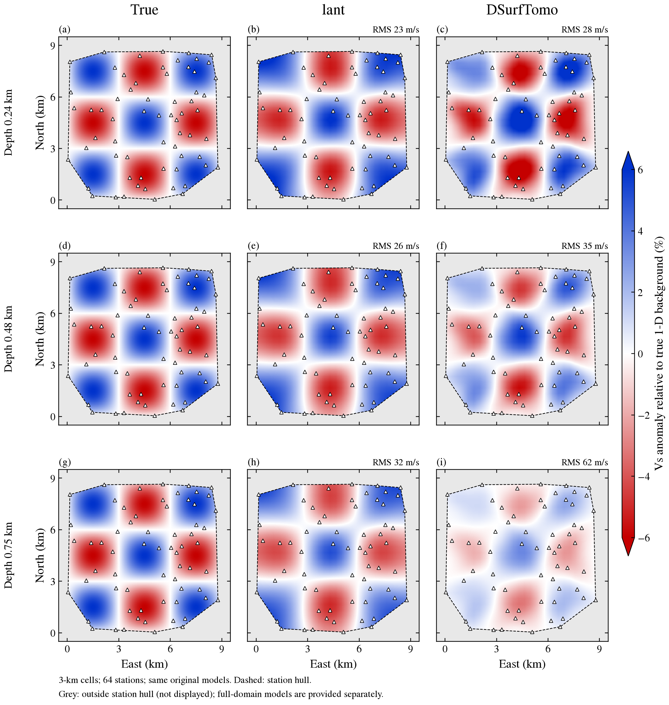
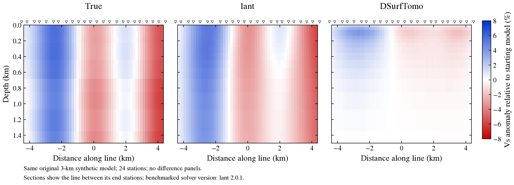
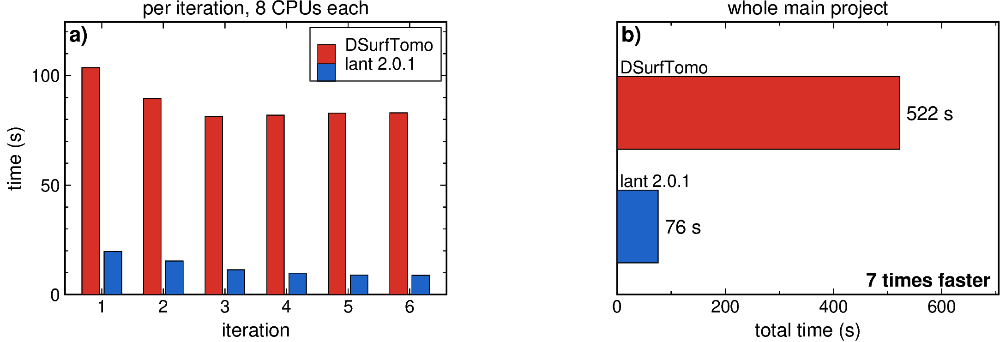

# local_ANT

**面向密集节点台阵的高频背景噪声面波成像：从原始记录到三维横波速度模型。**

[](https://github.com/Shubin-Wei/local_ANT/actions/workflows/tests.yml)
[](https://github.com/Shubin-Wei/local_ANT/releases)
[](pyproject.toml)
[](LICENSE)

中文 | [English](README.md)

## 概述

lant 是用于密集台阵（面状台阵和测线）高频背景噪声成像的命令行流程。输入为任意目录结构、ObsPy 可读的任意格式的连续原始记录，输出为三维 Vs 模型及其频散数据、分辨率检验和运行报告。

- **三项输入。** 原始数据目录、台站表、输出目录。其余参数均有成文的默认值，或按成文规则由数据推出；每一步的报告列出推导过程及所代入的本数据数值。
- **科学判断由使用者作出。** 流程只在需要科学判断处停止（例如拾取的脊是否为基阶），给出应查看的图件，并记录决定及其理由。
- **方法与工程选择分开说明。** 核心方法注明文献及适用条件；具体门限、自动规则和显示方式也含经验性的工程选择，不能由方法文献推断每个默认值都有直接出处。
- **可追溯、可续算。** 每一步记录输入、参数、代码版本和输出；参数改变后，受影响的步骤自动标为过时；运行中断后从中断处继续。
- **成果清晰。** `REPORT.md` 给出各步骤状态、关键数字、待判断事项和主要图件；`results/` 中为表格形式的模型、频散数据、图件和检验结果。

## 处理流程



| 步骤 | 内容 | 方法依据 |
|---|---|---|
| `clean` | 读取记录并与台站表对应，划分处理日；提供响应文件时去除仪器响应；检验每秒一次的授时脉冲 | Bensen et al. (2007)；Takagi et al. (2015) |
| `cc` | 垂直分量逐小时互相干 | Xu et al. (2021) |
| `stack` | 叠加与子叠加；以留一法相关系数和时移诊断台站 | Stehly et al. (2007)；Sens-Schönfelder (2008) |
| `reference` | 由台阵频率—贝塞尔谱得到参考相速度曲线 | Wang et al. (2019) |
| `disp` | 两台法相速度：相位匹配滤波、刀切法误差、质量控制 | Yao et al. (2006)；Levshin & Ritzwoller (2001)；Bensen et al. (2007) |
| `inversion`、`run` | 一维起始模型；由走时直接反演三维 Vs（DSurfTomo 的方法移植为 Python，正则化、剔除和求解为 lant 的） | Fang et al. (2015)；[方法](docs/methods.zh.md)第 8.3–8.4 节 |
| `evaluate`、`figures` | 残差、棋盘恢复与对照反演；平面图、剖面和频散图 | Lévêque et al. (1993)；Rawlinson & Spakman (2016) |

## 安装

环境要求：Linux、conda（或 mamba）、git。lant 从本仓库安装，不在 PyPI 上（PyPI 上的 `lant` 是无关的软件包）。

```bash
git clone https://github.com/Shubin-Wei/local_ANT.git && cd local_ANT
conda env create -f environment.yml && conda activate lant   # Python、ObsPy、GMT 6 及 lant 本身
lant check                                                   # 列出缺失项及其安装方法
```

## 快速开始

处理自己的数据：

```bash
lant run all --raw /data/raw --stations /data/stations.csv --out /data/result
```

该命令写出 `/data/result/config.yaml` 并开始运行。需要科学判断时，流程停止并给出应查看的文件和下一条命令：

```bash
lant status -c /data/result/config.yaml        # 各步骤状态及下一条命令
lant confirm reference -c /data/result/config.yaml --reason "拾取沿 3_fj_phase_velocity.png 中的基阶脊"
lant run all -c /data/result/config.yaml       # 从第一个不成立的步骤继续
```

`lant plan -c CONFIG` 在运行之前列出每一步将要执行的内容及所用数值。完整的入门过程见[快速上手](docs/quickstart.zh.md)。

## 输出

```text
/data/result/
├── REPORT.md     状态、关键数字、待判断事项、主要图件
├── results/      model/vs_model.csv、dispersion/curves.csv、figures/、validation/、parameters.yaml
├── work/         各步骤的处理文件（保留：重跑、重画不必重算）
├── .lant/        状态、步骤报告、配置历史、来源记录、日志
└── notes.md      使用者的笔记与决定
```

各文件的说明见 [docs/outputs.zh.md](docs/outputs.zh.md)。

## 已知模型上的检验

反演层面的合成测试（[docs/validation.zh.md](docs/validation.zh.md)）：给定台站布局，算出已知模型（一维背景上 ±6 %、格子 3 km 的棋盘）的走时，加周期 2.5 % 的高斯噪声，lant 和原版 DSurfTomo 在同样 8 个 CPU 上反演同一份输入文件。正则化和剔除各用各的（lant：权重 1；DSurfTomo：权重 1、阻尼 1）。

| 测试 | 反演 | 与真值的均方根误差（起始模型 88.5 / 82.0 m/s） | 异常恢复比例 | 用时（8 CPU） |
|---|---|---:|---:|---:|
| 面阵，64 台 | **lant** | **31.4 m/s** | 0.82 | **76 s** |
| | DSurfTomo | 60.0 m/s | 0.44 | 522 s |
| 测线，24 台 | **lant** | **15.3 m/s** | 0.91 | **72 s** |
| | DSurfTomo | 65.5 m/s | 0.25 | 1522 s |

该测试反演的是加了噪声的精确走时，不检验频散测量；实际数据含测量误差和理论近似误差，可以预期恢复得更少。



<sub>面阵，64 个台站（三角形），16 223 条走时。各列：真实模型、lant、DSurfTomo、lant − 真值、DSurfTomo − 真值；虚线为台站凸包，均方根误差在凸包内统计。台阵以外两个模型都没有数据约束。</sub>



<sub>测线，24 个台站（倒三角），3 143 条走时：两端台站之间沿线的 Vs 异常及各模型与真值之差。</sub>



<sub>面阵：6 次迭代各自的用时和整个主工程的用时，两者绑在同样的 8 个 CPU 上。</sub>

## 适用范围与限制

- 仅处理垂直分量（ZZ，基阶 Rayleigh 波）；支持面状台阵和测线（每条测线一个工程）。
- 假定噪声场接近各向同性；噪声方向性引起的偏差未经检验。
- 仅支持 Linux。台站坐标须为经纬度；跨越日界线或纬度高于 80° 的台阵不予处理。
- 三维反演最多 60 个周期（DSurfTomo 的 CalSurfG）。台站坐标与 DSurfTomo 一样是单精度（约 0.4 m）；观测走时和预测走时用同一组坐标，在检验工程中进入反演的台对（0.5 km 以上，更短的被波长规则去掉）的距离与双精度相差不超过 0.2 %。
- 不提供响应文件时，所有台站须为同一型号仪器；同型号仪器之间的公差会引入约为走时 0.1–1 % 的随机相位误差。
- 合成检验的具体数字见 [docs/validation.zh.md](docs/validation.zh.md)。

全部用 Python 运行：反演是 DSurfTomo 的移植版，正演部分（快速行进、射线、相速度）与原版一致，2.0.1 起正则化、剔除和最小二乘求解为 lant 自己的；与原版的对比和每一处不同见 [docs/python_backends.zh.md](docs/python_backends.zh.md)。

## 文档

| 文档 | 内容 |
|---|---|
| [快速上手](docs/quickstart.zh.md) | 安装、处理自己的数据、流程停下等你判断的地方 |
| [教程](docs/tutorial.zh.md) | 数据准备及每一步的目的、做法、参数和检查要点 |
| [方法](docs/methods.zh.md) | 原理、公式、文献依据和适用条件 |
| [参数](docs/parameters.zh.md) | 每个配置键的默认值、含义和依据 |
| [输出文件](docs/outputs.zh.md) | 每个输出文件的内容及查看时机 |
| [常见问题](docs/troubleshooting.zh.md) | 按步骤排列的常见问题与处理方法 |
| [验证](docs/validation.zh.md) | 合成检验及其数字 |
| [AI 助手](docs/ai_workflow.zh.md) | 借助 AI 助手运行流程 |
| [版本记录](docs/history.zh.md) | 各版本的变化 |
| [参与贡献](CONTRIBUTING.zh.md) | 问题报告、开发规范和检查 |

## 引用

请引用本流程所依据的方法（见上表，完整文献见 [docs/parameters.zh.md](docs/parameters.zh.md)），以及 DSurfTomo（Fang et al. 2015, *Geophys. J. Int.* 201, 1251–1263）及其移植所依据的方法（包括 Herrmann 的 surf96，Herrmann 2013）、ObsPy 和 GMT。本软件的引用信息见 [CITATION.cff](CITATION.cff)。

## 许可

MIT，见 [LICENSE](LICENSE)。反演模块 `lant/inversion/dsurf_*.py` 移植自 DSurfTomo（MIT，Fang et al. 2015）。
