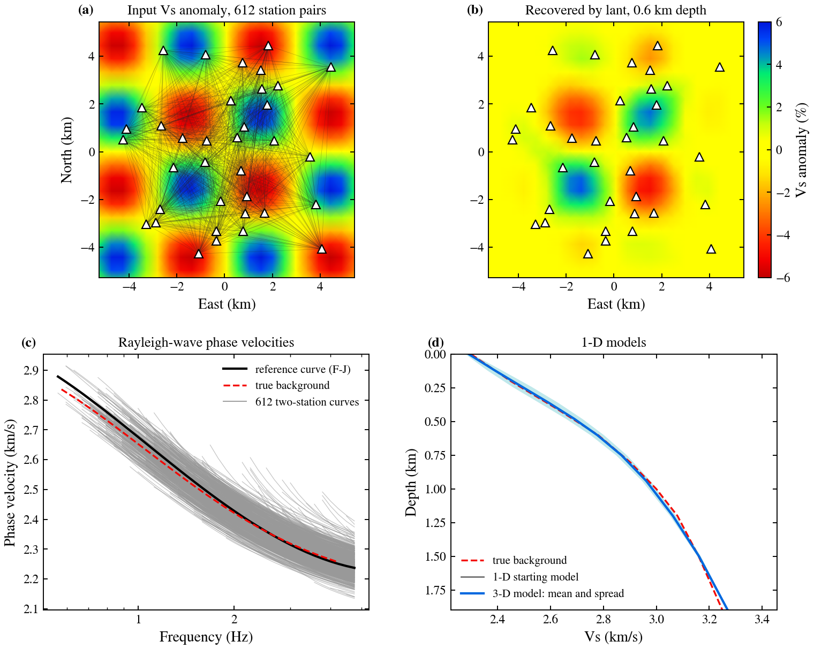
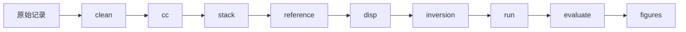

# local_ANT

**面向密集节点台阵的高频背景噪声面波成像：从原始记录到三维横波速度模型。**

[](https://github.com/Shubin-Wei/local_ANT/actions/workflows/tests.yml)
[](https://github.com/Shubin-Wei/local_ANT/releases)
[](pyproject.toml)
[](LICENSE)

中文 | [English](README.md)



<sub>**已知真值的合成检验**（可用 `python tools/readme_figure.py` 复现）。36 个随机分布的台站，横波速度含 ±6 %、3 km 格子的棋盘异常，并加入 2 % 的非相干噪声。(a) 输入异常与反演所用的 612 个台站对；(b) lant 在 0.6 km 深度恢复的横向 Vs 异常；(c) 两台法相速度、台阵参考曲线与真实背景；(d) 真实背景、一维起始模型及三维模型的水平平均与离散范围。恢复程度向射线覆盖边缘减弱，实际模型须结合棋盘测试解释。</sub>

## 概述

lant 是用于密集台阵（面状台阵和测线）高频背景噪声成像的命令行流程。输入为任意目录结构、ObsPy 可读的任意格式的连续原始记录，输出为三维 Vs 模型及其频散数据、分辨率检验和运行报告。

- **三项输入。** 原始数据目录、台站表、输出目录。其余参数均有成文的默认值，或按成文规则由数据推出；每一步的报告列出推导过程及所代入的本数据数值。
- **科学判断由使用者作出。** 流程只在需要科学判断处停止（例如拾取的脊是否为基阶），给出应查看的图件，并记录决定及其理由。
- **方法均有依据。** 每一步依据已发表的方法，并注明适用条件；没有文献依据的默认值标为经验值。
- **可追溯、可续算。** 每一步记录输入、参数、代码版本和输出；参数改变后，受影响的步骤自动标为过时；运行中断后从中断处继续。
- **成果清晰。** `REPORT.md` 给出各步骤状态、关键数字、待判断事项和主要图件；`results/` 中为表格形式的模型、频散数据、图件和检验结果。

## 处理流程



| 步骤 | 内容 | 方法依据 |
|---|---|---|
| `clean` | 读取记录并与台站表对应，划分处理日；提供响应文件时去除仪器响应；检验每秒一次的授时脉冲 | Bensen et al. (2007)；Takagi et al. (2015) |
| `cc` | 垂直分量逐小时互相干 | Xu et al. (2021) |
| `stack` | 叠加与子叠加；以留一法相关系数和时移诊断台站 | Stehly et al. (2007)；Sens-Schönfelder (2008) |
| `reference` | 由台阵频率—贝塞尔谱得到参考相速度曲线 | Wang et al. (2019) |
| `disp` | 两台法相速度：相位匹配滤波、刀切法误差、质量控制 | Yao et al. (2006)；Levshin & Ritzwoller (2001)；Bensen et al. (2007) |
| `inversion`、`run` | 一维起始模型；用 DSurfTomo 或 pDSurfTomo 由走时直接反演三维 Vs | Fang et al. (2015) |
| `evaluate`、`figures` | 残差、棋盘恢复与对照反演；平面图、剖面和频散图 | Lévêque et al. (1993)；Rawlinson & Spakman (2016) |

## 安装

环境要求：Linux、conda（或 mamba）、git。lant 从本仓库安装，不在 PyPI 上（PyPI 上的 `lant` 是无关的软件包）。

```bash
git clone https://github.com/Shubin-Wei/local_ANT.git && cd local_ANT
conda env create -f environment.yml && conda activate lant   # Python、ObsPy、GMT 6、编译器及 lant 本身
lant install-external                                        # 编译固定版本的 DSurfTomo 和 pDSurfTomo
lant check                                                   # 列出缺失项及其安装方法
```

## 快速开始

先在已知答案的合成台阵上运行完整流程（数分钟）：

```bash
lant demo --out ~/lant_demo
```

处理自己的数据：

```bash
lant run all --raw /data/raw --stations /data/stations.csv --out /data/result
```

该命令写出 `/data/result/config.yaml` 并开始运行。需要科学判断时，流程停止并给出应查看的文件和下一条命令：

```bash
lant status -c /data/result/config.yaml        # 各步骤状态及下一条命令
lant confirm reference -c /data/result/config.yaml --reason "拾取沿 fj.png 中的基阶脊"
lant run all -c /data/result/config.yaml       # 从第一个不成立的步骤继续
```

`lant plan -c CONFIG` 在运行之前列出每一步将要执行的内容及所用数值。完整的入门过程见[快速上手](docs/quickstart.zh.md)。

## 输出

```text
/data/result/
├── REPORT.md     状态、关键数字、待判断事项、主要图件
├── results/      model/vs_model.csv、dispersion/、figures/、validation/、reproduce/
├── work/         各步骤的处理文件
├── .lant/        状态、步骤报告、配置历史、来源记录、日志
└── notes.md      使用者的笔记与决定
```

各文件的说明见 [docs/outputs.zh.md](docs/outputs.zh.md)。

## 适用范围与限制

- 仅处理垂直分量（ZZ，基阶 Rayleigh 波）；支持面状台阵和测线（每条测线一个工程）。
- 假定噪声场接近各向同性；噪声方向性引起的偏差未经检验。
- 仅支持 Linux。台站坐标须为经纬度；跨越日界线或纬度高于 80° 的台阵不予处理。
- DSurfTomo 最多支持 60 个周期（pDSurfTomo 为 80 个）；台距小于约 200 m 的台对受其单精度坐标影响存在测距误差。
- 不提供响应文件时，所有台站须为同一型号仪器；同型号仪器之间的公差会引入约为走时 0.1–1 % 的随机相位误差。
- 合成检验的具体数字见 [docs/validation.zh.md](docs/validation.zh.md)。

## 文档

| 文档 | 内容 |
|---|---|
| [快速上手](docs/quickstart.zh.md) | 安装、合成数据试运行、处理自己的数据 |
| [教程](docs/tutorial.zh.md) | 数据准备及每一步的目的、做法、参数和检查要点 |
| [方法](docs/methods.zh.md) | 原理、公式、文献依据和适用条件 |
| [参数](docs/parameters.zh.md) | 每个配置键的默认值、含义和依据 |
| [输出文件](docs/outputs.zh.md) | 每个输出文件的内容及查看时机 |
| [常见问题](docs/troubleshooting.zh.md) | 按步骤排列的常见问题与处理方法 |
| [验证](docs/validation.zh.md) | 合成检验及其数字 |
| [AI 助手](docs/ai_workflow.zh.md) | 借助 AI 助手运行流程 |
| [版本记录](docs/history.zh.md) | 各版本的变化 |
| [参与贡献](CONTRIBUTING.zh.md) | 问题报告、开发规范和检查 |

## 引用

请引用本流程所依据的方法（见上表，完整文献见 [docs/parameters.zh.md](docs/parameters.zh.md)），以及 DSurfTomo（Fang et al. 2015, *Geophys. J. Int.* 201, 1251–1263）、使用时的 pDSurfTomo（Zhu et al. 2026, arXiv:2604.11920）、ObsPy 和 GMT。本软件的引用信息见 [CITATION.cff](CITATION.cff)。

## 许可

MIT，见 [LICENSE](LICENSE)。DSurfTomo（MIT）和 pDSurfTomo（GPL-3）由 `lant install-external` 下载编译，各自保留其许可，不包含在本仓库中。
