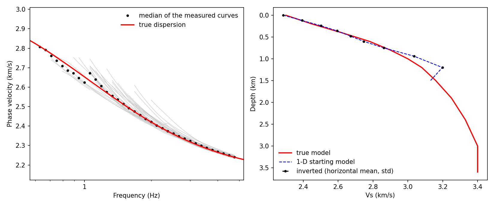

# local_ANT

[](https://github.com/Shubin-Wei/local_ANT/actions/workflows/tests.yml)
[](pyproject.toml)
[](LICENSE)
[](docs/history.md)

中文 | [English](README.md)

密集（节点）台阵高频背景噪声面波成像的完整流程：从原始记录到三维横波速度模型。一个命令行入口 `lant`，一份配置文件；每一步都写出报告，说明做了什么、用了哪些数值、哪些事留给你判断。



*已知真值的合成算例：左侧为频散，右侧为横向平均 Vs。这是横向均匀介质示例，不代表一般三维分辨率验证。*

先打开 `OUT/REPORT.md`。科学成果在 `results/`，计算文件在 `work/`，状态和轮转日志在 `.lant/`。手动运行在 stderr 显示进度，`lant run ... -v` 查看详情。见[输出说明](docs/outputs.zh.md)。

```
原始记录 ─ clean ─ cc ─ stack ─ reference ─ disp ─ inversion ─ run ─ evaluate ─ figures
```

| 步骤 | 做什么 | 方法依据 |
|---|---|---|
| `clean` | 读任意目录结构、ObsPy 能读的任意格式；把台站表与记录对上；切出处理日；给了响应文件就去仪器响应；检验有没有每秒一次的授时脉冲 | Bensen et al. (2007)；Takagi et al. (2015) |
| `cc` | 垂直分量逐小时互相干 | Xu et al. (2021) |
| `stack` | 叠加和子叠加；台站诊断（留一法的相关系数和时移） | Stehly et al. (2007)；Sens-Schönfelder (2008) |
| `reference` | 由本台阵的频率—贝塞尔谱得到参考相速度曲线 | Wang et al. (2019) |
| `disp` | 两台法相速度（相位匹配滤波）、刀切误差、质量控制 | Yao et al. (2006)；Levshin & Ritzwoller (2001)；Bensen et al. (2007) |
| `inversion`、`run` | 一维起始模型；用 DSurfTomo（或 pDSurfTomo）由走时直接反演三维 Vs | Fang et al. (2015) |
| `evaluate`、`figures` | 残差、棋盘恢复、对照反演；平面图、剖面等成果图 | Lévêque et al. (1993)；Rawlinson & Spakman (2016) |

## 你给什么，程序定什么

你只需要给三个路径：原始数据、台站表、输出目录。其余参数要么有默认值，要么按写明的规则由数据推出，步骤报告里把每条推导连同代入的数写出来。程序只在需要你做科学判断的地方停下（例如：拾取的是不是基阶），并告诉你看哪张图、下一条命令是什么。

## 适用范围与限制

- 只做垂直分量（ZZ，基阶 Rayleigh 波）。支持面状台阵和线状台阵（一条测线一个项目）。
- 假定噪声场接近各向同性；噪声方向性带来的偏差没有检验。
- 只支持 Linux。台站坐标用经纬度（不支持投影坐标）。跨日界线或纬度高于 80° 的台阵会被拒绝。
- DSurfTomo 最多 60 个周期（pDSurfTomo 80 个）；台距小于约 200 m 的台对，受其单精度坐标影响有测距误差。
- 不给响应文件时，全部台站必须是同一型号。同型号的个体之间仍有公差，会留下量级为走时 0.1–1 % 的随机相位误差。
- 合成检验的数字见 [docs/validation.zh.md](docs/validation.zh.md)。

## 安装

```bash
git clone https://github.com/Shubin-Wei/local_ANT.git && cd local_ANT
conda env create -f environment.yml && conda activate lant     # Python、ObsPy、GMT 6、gfortran
pip install -e .
lant install-external                                  # DSurfTomo 和 pDSurfTomo（固定版本）
lant check                                                      # 缺什么、怎么装，都会列出
```

## 快速开始

```bash
lant run all --raw /data/raw --stations /data/stations.csv --out /data/result
```

这条命令写出 `/data/result/config.yaml` 并开始运行。停下时会打印要看的文件和下一条命令，例如

```bash
lant confirm reference -c /data/result/config.yaml
lant run all -c /data/result/config.yaml          # 从第一个不成立的步骤接着跑
```

`lant status -c 配置` 给出每一步的状态和下一条命令；`lant plan -c 配置` 在运行前列出每一步将要做什么。想先在已知答案的数据上试一遍：[docs/quickstart.zh.md](docs/quickstart.zh.md)（约半小时，含安装）。

## 文档

| | |
|---|---|
| [docs/quickstart.zh.md](docs/quickstart.zh.md) | 快速上手：安装，在合成数据上跑完一遍，换成自己的数据 |
| [docs/tutorial.zh.md](docs/tutorial.zh.md) | 教程：数据准备、每一步的目的、做法、参数和要看的图 |
| [docs/methods.zh.md](docs/methods.zh.md) | 方法：每一步的原理、公式、文献依据和适用条件 |
| [docs/outputs.zh.md](docs/outputs.zh.md) | 每个输出文件的内容和什么时候看 |
| [docs/troubleshooting.zh.md](docs/troubleshooting.zh.md) | 按步骤排列的常见问题与处理 |
| [docs/parameters.zh.md](docs/parameters.zh.md) | 每个配置键：默认值、含义、默认值的依据 |
| [docs/ai_workflow.zh.md](docs/ai_workflow.zh.md) | 借助 AI 助手运行流程 |
| [docs/validation.zh.md](docs/validation.zh.md) | 合成检验及其数字 |
| [docs/history.zh.md](docs/history.zh.md) | 各版本的变化 |
| [AGENTS.zh.md](AGENTS.zh.md) | 给在本仓库里工作的 AI 助手的说明 |

## 引用

使用本流程时，请引用它所依据的方法（见上表，完整文献在 [docs/parameters.zh.md](docs/parameters.zh.md)）和第三方程序 DSurfTomo（Fang et al. 2015, GJI 201:1251）、pDSurfTomo（Zhu et al. 2026, arXiv:2604.11920，用到时），以及 ObsPy 和 GMT。

## 许可

MIT（见 `LICENSE`）。第三方程序由 `tools/install_external.sh` 下载，保留各自的许可（DSurfTomo MIT、pDSurfTomo GPL-3），不包含在本仓库中。
