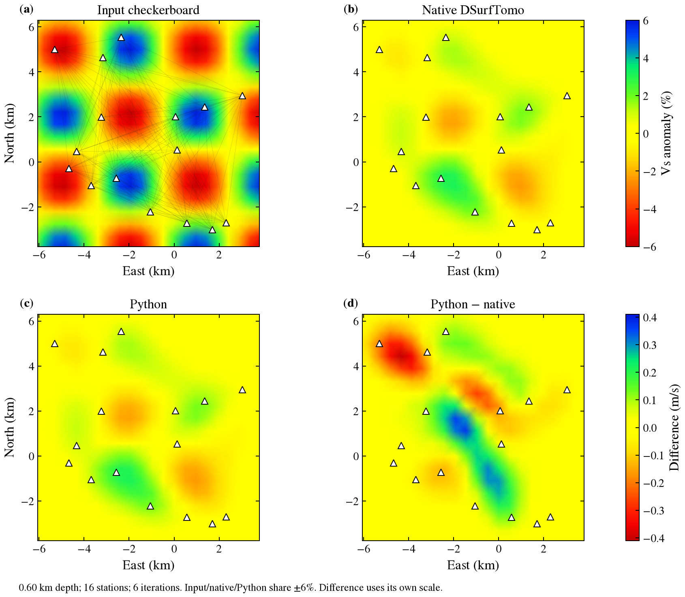
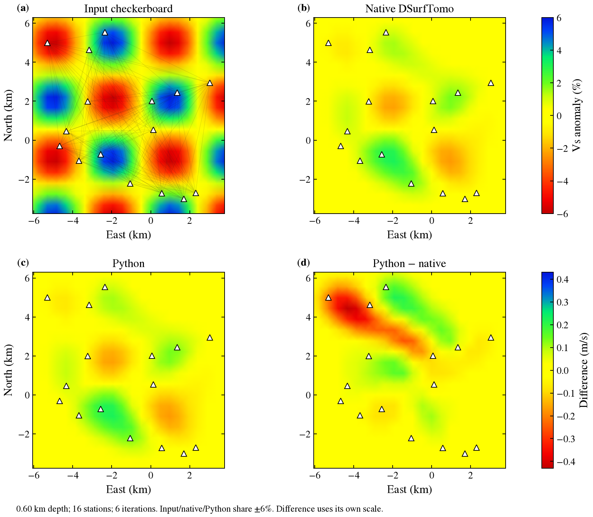
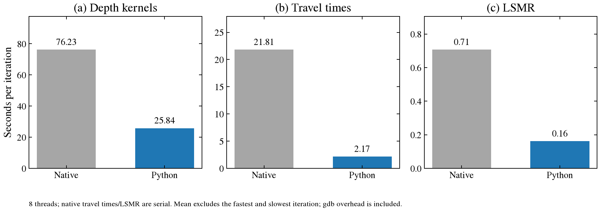

# The Python port of DSurfTomo

[中文](python_backends.zh.md) | English

lant's 3-D inversion is a statement-by-statement Python/Numba port of DSurfTomo `a651faf` (Fang et al. 2015): its main program (`main.f90`) and the forward part of CalSurfG, for fundamental Rayleigh phase velocities. It reads and writes DSurfTomo's own files under their names and formats, so a project directory can be read as a DSurfTomo project. Before 2.0 lant called the Fortran program; the port is checked against it with the comparisons below.

## How lant runs it

For every solver project lant starts `python -m lant.inversion.solver --threads N` in the project directory. It runs `dsurf_main` on `DSurfTomo.in`, `surfdata.dat` and `MOD` and then writes `solver.json` (the identity of the implementation: package versions and the hashes of these modules; the threads; the seconds of every module in every iteration; the peak memory) and `DWS.dat` (the DWS of every node in the last iteration, used for the checkerboard numbers). A project counts as finished only with a `solver.json` of the current implementation. The number of threads follows `resources.cores` ([parameters.md](parameters.md)). Prechecks, the checkerboard noise and the residuals evaluate the first iteration without the inversion in the lant process (`lant.inversion.solver.evaluate`).

On its own, `python -m lant.inversion.dsurf_main DSurfTomo.in` runs the inversion in the current directory like the Fortran program; `--threads N`, by default lant's rule (80 % of the idle cores).

## Forward part

| Module | Fortran routine it follows |
|---|---|
| `dsurf_input` | reading of `DSurfTomo.in`, `surfdata.dat` and `MOD` in `main.f90`, `delsph.f90` |
| `dsurf_bspline` | `gridder`, `bsplrefine` |
| `dsurf_fmm` | `travel`, `fouds2`, `addtree`, `downtree`, `updtree`, `bilinear` |
| `dsurf_source` | the source-grid refinement block of `CalSurfG`, `srtimes` |
| `dsurf_rays` | `rpaths` |
| `dsurf_rows` | the row assembly in `CalSurfG` (Brocher chain, `ftol`, column order) |
| `dsurf_disp96` | `surfdisp96.f` (Rayleigh phase velocity, spherical, fundamental mode: `sphere`, `gtsolh`, `getsol`, `nevill`, `half`, `dltar4`, `var`, `dnka`, `normc`), and from CalSurfG the Brocher materials and `refineGrid2LayerMdl` |
| `dsurf_kernels` | `depthkernel`, `caldespersion` (the column loop over `dsurf_disp96`) |
| `dsurf_forward` | the period/source loop; node kernels from `dsurf_kernels` or supplied |

The fixed CalSurfG settings are kept (`gdx=gdz=8`, `sgdl=8`, `sgs=8`, Earth radius 6371 km, `fom=1`, so the unused first-order `fouds1` is not ported). `real=np.float32` reproduces the Fortran REAL arithmetic step by step; `np.float64` runs the same algorithm in double from the same REAL inputs. Reference behaviour is reproduced rather than corrected: rays starting within `2*dpl` of the source or in the refined source cell give an empty row; the closing segment to the source is not integrated; at a B-spline cell face the previous point's basis values are added to the new cell's vertices; the four source seeds divide an angular distance by velocity; near the source, receiver times are `2d/(vs+vr)`; observed times use the single-precision haversine; a period that reappears in `surfdata.dat` overwrites its earlier sources. Only fundamental Rayleigh phase velocities are accepted. Sources are computed in parallel (`prange`), each with its own fields and heap. One addition of lant: the coarse march of a source stops once every node its receivers' times and rays read is done (the corners of the receiver cells, plus a margin of two cell diagonals at the slowest velocity); the nodes it leaves are later than all of them, so every value read is the native one, and the travel-time part takes about half the time.

## Inversion

| Module | What of `main.f90` it follows |
|---|---|
| `dsurf_main` | the program: reading, synthetic data, iteration loop, update, output (the module docstring lists every step with its line numbers) |
| `dsurf_system` | residuals, `getpercentile` and the quartile rejection, DWS, smoothing rows, residual statistics |
| `dsurf_lsmr` | `lsmrModule.f90` with `dp = kind 4`, `aprod.f90`, `lsmrblas.f90` |
| `dsurf_format` | gfortran list-directed and `Fw.d` output |

Everything is reproduced as the Fortran does it, quirks included: REAL arithmetic wherever `main.f90` declares REAL (residuals, rejection, matrix, LSMR, update); LSMR in single precision with `atol = btol = 1e-6`, `conlim = 100`, `itnlim = 400` and local reorthogonalization over 10 vectors (`scipy.sparse.linalg.lsmr` is double precision without local reorthogonalization, so it is not used); the residual `obst(i) - dsyn(i)` index by index between file order and CalSurfG order; rejection outside `threshold x [q25, q75]` on the signed quartiles, with rejected rows kept as zero rows; the smoothing rows only on the diagonal at the faces of the parameter box; the velocity change clipped to ±0.5 km/s and the model to the velocity bounds; the logged residual of iteration *k* belongs to the model before update *k*; the synthetic data computed on a propagation grid diced 5 × 5 instead of 8 × 8, as CalSurfG's `synthetic`; `velmap2dRc.dat` labelled with the Fortran's offset index. `spfra` only sizes arrays: the run stops when the nonzeros exceed it, as native. Not reproduced: gfortran's random stream for `noiselevel > 0` (a stand-in Marsaglia draw is used, zero added noise removes the random-stream difference, while dispersion kernels can still produce different synthetic observations), the boundary-ray warning on the screen, group and Love data.

The depth kernels follow DSurfTomo's own dispersion code in its own precision: the layer model, the earth flattening and the stored phase velocity are REAL, the dispersion function and the root search double, REAL constants keep their single-precision value in double expressions, and integer powers are multiplied as gfortran expands them. Their phase velocities and Vs, Vp and density partials equal the native depthkernel bit for bit (a stored native output is a test). `dsurf_kernels` solves identical columns once and computes partials only where CalSurfG reads them (interior columns, nodes above the last depth). Not reproduced: native depthkernel shares getsol's SAVE variable between its OpenMP threads; here it is local to each call (the value of a serial run).

## Agreement with the original (2.0.0)

On the inputs of four earlier native runs - the synthetic areal (16 stations) and line (24 stations) projects of the repository's generator, pDSurfTomo's `example_syn` at five periods (synthetic flag 1), and an unpublished 55-station line - the port's outputs of ten iterations are byte-identical to native DSurfTomo `a651faf`: every `.iterNNN` model, the final model, `residualFirst.dat`, `residualLast.dat` and, for the synthetic case, `DSurfTomo.inSyn.dat`, `velmap2dRc.dat` and `Vs_model.real`. The log differs in its third line only, the banner that names this port. Before 2.0.0 the kernels came from disba (close to surfdisp96, not bitwise equal); the comparisons below are of that version.

## Current shared-observation comparison

The current comparison uses identical observations, initial model, grid and controls for six checkerboard iterations in measured-data mode. Input bytes and float32 observed times were checked for equality. Final model maximum/RMS differences are 0.440/0.0506 m/s; with nine threads each, native/Python wall times are 524.07/154.57 s. Recovery remains weak; implementation agreement does not establish resolution. For the real-data ten-iteration comparison, native is complete and Python is running; no real-data difference is reported yet.

The following independently synthesized comparison is historical and does not replace the shared-observation comparison above.

## Comparison with the original

The earlier comparison uses a sinusoidal checkerboard, following the README overview: ±6 % Vs, 3-km cells, 16 stations, 2884 travel times at 32 periods, a 33 × 35 × 11 grid and six iterations. Both programs read copies of the same `DSurfTomo.in`, `MOD`, `MOD.true` and `surfdata.dat`. Synthetic observations use each solver's own forward calculation with zero added noise. The comparison fixes weight = damping = 1 and uses 8 threads; this benchmark setting does not replace lant's automatic resource or regularization defaults.

At 0.60 km depth, input, native and Python use the same ±6 % colour limits. The difference panel has its own scale in m/s. The recovered amplitude is weak at this cell size and fixed regularization; agreement between implementations does not establish resolution. The map shows the station area, while the error numbers below include every output node and depth.

| Final model difference, Python − native | km/s |
|---|---:|
| Largest absolute difference | 4.90e-4 |
| RMS difference | 4.5632e-5 |

(Before 2.0.0.) The disba and native dispersion kernels are close, not bitwise identical. The final model difference includes the resulting differences in synthetic travel times, rejection and the nonlinear inversion path. Earlier separate lateral-model comparisons using native kernels in the Python driver gave identical model values at every iteration and identical first/last residual files; those isolate the port from the dispersion-kernel difference. One- and eight-thread disba runs on those earlier fixtures also agreed. These are checks on specific inputs, not a universal equivalence bound.

| Module | Native (s) | Python (s) | Native / Python |
|---|---:|---:|---:|
| Depth kernels (SenK) | 76.23 | 25.84 | 2.95 |
| Travel times | 21.81 | 2.17 | 10.04 |
| LSMR | 0.707 | 0.162 | 4.38 |

Times are the mean of six iterations after dropping the fastest and slowest. Both use the same server and an eight-thread budget; native SenK uses OpenMP, while its travel-time and LSMR stages are serial. Native is timed through entry/return breakpoints in the unmodified binary (gdb overhead included); Python uses internal timers. These module ratios are not end-to-end workflow speedups. Package versions, source/input hashes and the unrounded numbers are in [the comparison record](assets/solver_checkerboard_summary.json). No real records were reprocessed for these figures.

`tools/plot_solver_comparison.py --case VALIDATION_DIR --out FIGURE_DIR` redraws the figures from completed solver outputs without running either solver. The validation directory needs `inputs/`, `native/`, `python/` and `case.json`; its path and the run commands are in the local handoff record.

## Sources and licences

- [DSurfTomo](https://github.com/HongjianFang/DSurfTomo), pinned `a651faf92758c1b4c5eb494a4865ef797b9a4b1c`, MIT; Fang et al. (2015), doi:10.1093/gji/ggv080. The ported program.
- Herrmann (2013), *Seismol. Res. Lett.* 84(6), 1081–1088, doi:10.1785/0220110096: Computer Programs in Seismology, whose surf96 DSurfTomo's surfdisp96.f modifies.
- LSMR: Fong & Saunders (2011), doi:10.1137/10079687X, as in DSurfTomo's `lsmrModule.f90`.
- The comparison metrics follow pDSurfTomo (Zhu et al. 2026, arXiv:2604.11920).
- [PyGMT](https://www.pygmt.org/), BSD-3-Clause, wrapping GMT (LGPL), for `plots.backend: pygmt`.
