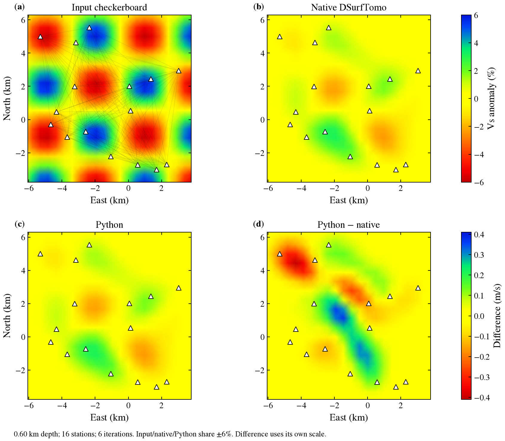
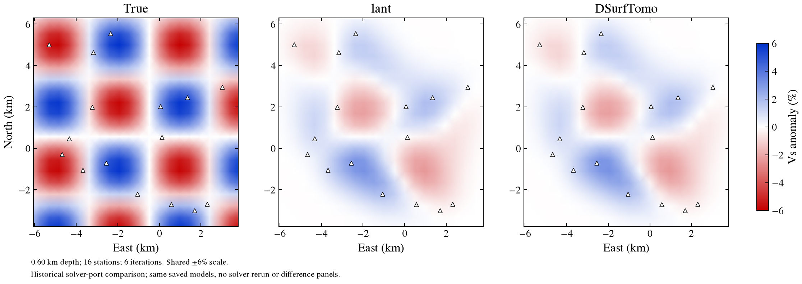
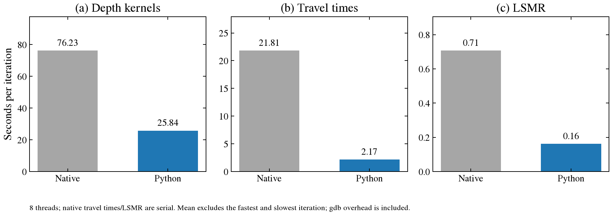

# DSurfTomo 的 Python 移植

中文 | [English](python_backends.md)

lant 的三维反演是 DSurfTomo `a651faf`（Fang et al. 2015）的 Python/Numba 移植：主程序（`main.f90`）和 CalSurfG 的正演部分，针对基阶 Rayleigh 相速度。它按 DSurfTomo 自己的文件名和格式读写文件，因此一个工程目录仍可当作 DSurfTomo 工程来读。正演部分（快速行进、射线、相速度）和 LSMR 求解器逐句移植。从 2.0.1 起，反演方法有意与 DSurfTomo 不同，每处改动都有依据：正则化、剔除规则、LSMR 的条件数上限，以及深度核的求导方式（见下文"2.0.1 的改动"）。2.0.0 的移植与原生 DSurfTomo 逐字节相同，那次对比保留在下文。

## lant 怎样运行它

每个反演工程，lant 在工程目录中启动 `python -m lant.inversion.solver --threads N`。它在 `DSurfTomo.in`、`surfdata.dat`、`MOD` 上运行 `dsurf_main`，然后写出 `solver.json`（实现的身份：依赖包版本和这些模块的哈希；线程数；每次迭代各模块的秒数；峰值内存）和 `DWS.dat`（最后一轮每个节点的 DWS，用于棋盘恢复数字）。只有带当前实现的 `solver.json` 的工程才算完成。线程数按 `resources.cores` 定（[parameters.zh.md](parameters.zh.md)）。预检、棋盘噪声和残差在 lant 进程内计算不反演的第一轮（`lant.inversion.solver.evaluate`）。

单独运行时，`python -m lant.inversion.dsurf_main DSurfTomo.in` 像 Fortran 程序一样在当前目录反演；`--threads N`，默认按 lant 的规则（空闲核的 80 %）。

## 正演部分

| 模块 | 对应的 Fortran 子程序 |
|---|---|
| `dsurf_input` | `main.f90` 读取 `DSurfTomo.in`、`surfdata.dat`、`MOD` 的部分，`delsph.f90` |
| `dsurf_bspline` | `gridder`、`bsplrefine` |
| `dsurf_fmm` | `travel`、`fouds2`、`addtree`、`downtree`、`updtree`、`bilinear` |
| `dsurf_source` | `CalSurfG` 中震源网格加密一段、`srtimes` |
| `dsurf_rays` | `rpaths` |
| `dsurf_rows` | `CalSurfG` 中的行组装（Brocher 链式关系、`ftol`、列顺序） |
| `dsurf_disp96` | `surfdisp96.f`（Rayleigh 相速度、球面、基阶：`sphere`、`gtsolh`、`getsol`、`nevill`、`half`、`dltar4`、`var`、`dnka`、`normc`），以及 CalSurfG 中的 Brocher 换算和 `refineGrid2LayerMdl` |
| `dsurf_kernels` | `depthkernel`、`caldespersion`（在 `dsurf_disp96` 上的逐列循环） |
| `dsurf_forward` | 周期/震源循环；节点核来自 `dsurf_kernels` 或由调用者提供 |

CalSurfG 中写死的设置保持不变（`gdx=gdz=8`、`sgdl=8`、`sgs=8`、地球半径 6371 km、`fom=1`，因此未用到的一阶 `fouds1` 没有移植）。`real=np.float32` 逐步重现 Fortran REAL 运算；`np.float64` 用同样的 REAL 输入、以双精度执行同一算法。参考程序的行为照原样重现，不作修正：射线起点距震源不足 `2*dpl` 或位于加密震源单元内时该行为空；连到震源的最后一段不积分；跨 B 样条单元边界时，前一点在旧单元中的基函数值加到新单元的顶点上；震源四个种子点用角距离除以速度；近震源的接收点走时为 `2d/(vs+vr)`；观测走时用单精度 haversine；`surfdata.dat` 中重复出现的周期会覆盖之前的震源。只接受基阶 Rayleigh 相速度。各震源用 `prange` 并行计算，每个震源有自己的走时场和堆。lant 加了一处：某个震源的粗网格推进，在其接收点走时和射线要读的节点都算完（接收点所在格子的角点，再加最慢速度下两个格子对角线的余量）之后就停止；没算的节点都比这些晚，所以读到的每个值都与原生相同，走时部分的时间约减半。

## 反演

| 模块 | 对应 `main.f90` 的内容 |
|---|---|
| `dsurf_main` | 主程序：读入、合成数据、迭代循环、更新、输出（模块说明逐步列出每一步及其行号） |
| `dsurf_system` | 残差、DWS、残差统计；lant 的 MAD 剔除（DSurfTomo 的四分位剔除和平滑行留作参照） |
| `model_regularization` | lant 的正则化（DSurfTomo 没有） |
| `dsurf_lsmr` | `dp = kind 4` 的 `lsmrModule.f90`、`aprod.f90`、`lsmrblas.f90`（留作参照；2.0.1 起迭代用 `least_squares` 求解） |
| `least_squares` | lant 的求解：列归一化后的双精度 LSMR（DSurfTomo 没有） |
| `dsurf_format` | gfortran 的表控输出与 `Fw.d` 输出 |

按 Fortran 的做法重现的（下面 2.0.1 的改动除外）：`main.f90` 声明为 REAL 的地方（残差、矩阵、更新）都用 REAL 运算；`dsurf_lsmr` 中 LSMR 为单精度，`atol = btol = 1e-6`、`itnlim = 400`，并对最近 10 个向量做局部再正交化；残差 `obst(i) - dsyn(i)` 按下标相减，前者为文件顺序、后者为 CalSurfG 顺序，被剔除的行保留为零行；速度改变量截断在 ±0.5 km/s，模型截断在速度上下限内；第 *k* 次迭代记录的残差属于第 *k* 次更新之前的模型；合成数据与 CalSurfG 的 `synthetic` 一样在 5 × 5 而不是 8 × 8 加密的传播网格上计算；`velmap2dRc.dat` 沿用 Fortran 错开一格的下标。没有重现的：`noiselevel > 0` 时 gfortran 的随机数序列（改用替代的 Marsaglia 抽样）、屏幕上的射线贴边警告、群速度和 Love 波数据。

## 2.0.1 的改动

| | DSurfTomo | lant 2.0.1 | 依据 |
|---|---|---|---|
| 正则化 | 平滑（Laplacian，参数盒子表面——包括最浅一层——只有对角元 2 × 权重）和 LSMR 阻尼都作用于每轮的改变量；数据行原样 | 平滑作用于模型本身（m + dv − m0，jumping），整个盒子的 Laplacian，每个节点用它实有的邻点，不用阻尼；数据项按保留的数据条数、模型项按参数个数取均值（`model_regularization`） | Shaw & Orcutt (1985)；Constable et al. (1987)；Aster et al. (2013)；[methods.zh.md](methods.zh.md) 第 8.4 节 |
| 剔除 | 带符号残差在 `threshold × [q25, q75]` 之外 | 偏离残差中位数超过 `outlier_mad` × 1.4826 MAD，二者都按周期算（`dsurf_system.reject_mad`） | Rousseeuw & Croux (1993)；Leys et al. (2013)；走时误差随周期增大（methods.md 8.3） |
| 最小二乘求解 | 单精度 LSMR，`atol = btol = 1e-6`、`itnlim = 400`、`conlim = 100`：容差接近 REAL 的分辨率，很少达到（面阵合成例 6 次迭代中有 4 次停在 400 次），条件数估计超过 100 也停止；两种提前停止都相当于第二种正则化，强弱随问题大小变化 | 每列归一化到单位长度后的双精度 LSMR，用原作者的容差（`atol = btol = 1e-6`、`conlim = 1e8`）和迭代上限 min(m, n)（`least_squares`） | Fong & Saunders (2011)；Paige & Saunders (1982)；Hansen (1998) |
| 深度核 | Vs、Vp、密度逐个扰动（每个节点 6 次频散计算），再用 Brocher 关系的 dVp/dVs、dρ/dVs 合成 | 沿 Brocher 关系求导（节点的 Vp、ρ 随其 Vs 变化）：每个节点 2 次计算，按链式法则与上面的合成相同，差别在有限差分误差以内（在存下的原生输出上与原生合成相差不超过 0.03 %；耗时约为三分之一），并且只算射线经过的网格柱（`dsurf_kernels.LazyKernels`；G 逐位不变；面阵合成例上 62 % 的节点没有数据） | 链式法则；没有射线经过的柱在 G 中没有元素 |
| 合成噪声 | `noiselevel` × 高斯数 × 走时 | 工程里有 `noise_seconds.txt` 时：高斯数 × 该行周期的标准差（秒），抽样相同（`dsurf_main.synthetic_data`） | 相位误差随周期增大，不随路径增长（methods.md 第 9 节） |
| 稀疏预留 | `spfra` 决定数组大小；太小则停止 | 按数据分配数组；读入该行但不使用 | — |

深度核用 DSurfTomo 自己的频散代码、按它自己的精度计算：分层模型、地球扁平化和存下的相速度用 REAL，频散函数和求根用双精度，REAL 常数在双精度表达式里保留单精度值，整数次幂按 gfortran 的展开顺序相乘。相速度与原生 depthkernel 逐位相同（以一份存下的原生输出作测试）。`dsurf_kernels` 对相同的列只算一次，只在 CalSurfG 读取的地方求导（内部各列、最后一个深度以上的节点）。未重现：原生 depthkernel 的各 OpenMP 线程共用 getsol 的 SAVE 变量；这里每次调用各用自己的（即单线程运行时的值）。

## 与原版一致（2.0.0）

在四个早先原生运行的输入上——仓库合成数据生成器的面状（16 台）和线状（24 台）工程、pDSurfTomo `example_syn` 的五个周期（合成标志 1）、一条未公开的 55 台测线——移植版十轮迭代的输出与原生 DSurfTomo `a651faf` 逐字节相同：每一轮的 `.iterNNN` 模型、最终模型、`residualFirst.dat`、`residualLast.dat`，合成算例还有 `DSurfTomo.inSyn.dat`、`velmap2dRc.dat` 和 `Vs_model.real`。日志只有第三行不同，即注明本移植的横幅。2.0.0 之前节点核来自 disba（与 surfdisp96 接近，但不逐位相同）；下面的对比都是那个版本的。

## 本轮共同观测对照

本轮对照使用同一份观测、初模、网格及控制文件进行六轮棋盘格对照，双方均以实测模式读取，核对观测字节及 float32 走时相同。最大／RMS 最终模型差为 0.440／0.0506 m/s；双方 9 线程，原版／Python 墙钟时间 524.07／154.57 s。恢复幅度仍弱，不能以实现一致证明分辨率。实测十轮对照中原版已完成，Python 正在计算，尚不报告实测差异。

以下为上一阶段各自合成观测的历史对照，不能替代上述共同观测比较。

## 与原生程序的对比

上一阶段对比使用正弦棋盘格：Vs 扰动 ±6 %、格子 3 km、16 个台站、32 个周期共 2884 个走时，33 × 35 × 11 网格，六次迭代。两个程序读取同一份 `DSurfTomo.in`、`MOD`、`MOD.true`、`surfdata.dat` 的副本。合成观测分别由各自的正演计算，均不加噪声。对比固定平滑权重 = 阻尼 = 1、8 线程；这些是基准设置，不替代 lant 自动选择资源和正则化的默认行为。

图示 0.60 km 深度，输入、原生与 Python 共用 ±6 % 色标，差值单独使用 m/s 色标。在这个格子大小与固定正则化下，恢复幅度偏弱；实现一致不等于分辨率充分。地图显示台站范围，下面的差异数字则包括所有输出节点和深度。

| 最终模型差异，Python − 原生 | km/s |
|---|---:|
| 最大绝对差 | 4.90e-4 |
| 均方根差 | 4.5632e-5 |

（2.0.0 之前。）Disba 与原生频散核接近，但不逐位相同；最终差异也包含合成走时、剔除集合和非线性迭代路径的影响。此前单独的横向结构算例中，Python 驱动使用原生核时，每轮模型数值以及首末轮残差文件与原生一致；这把移植与频散核差异分开检验。那些早期算例上的 disba 单线程与八线程结果也一致。这些结论只对应所测输入，不是普适误差界。

| 模块 | 原生（秒） | Python（秒） | 原生 / Python |
|---|---:|---:|---:|
| 深度核（SenK） | 76.23 | 25.84 | 2.95 |
| 走时 | 21.81 | 2.17 | 10.04 |
| LSMR | 0.707 | 0.162 | 4.38 |

耗时取六次迭代去掉最快、最慢后的平均。两者在同一服务器、同为八线程预算；原生 SenK 使用 OpenMP，走时与 LSMR 串行。原生程序未修改，通过 gdb 的入口／返回断点计时（含断点开销），Python 使用内部计时。这些模块加速比不是整条流程的加速比。依赖版本、源码／输入哈希及未取整数字见[对比记录](assets/solver_checkerboard_summary.json)。本次图件没有重跑真实记录。

`tools/plot_solver_comparison.py --case VALIDATION_DIR --out FIGURE_DIR` 从已完成的求解器输出重画图，不运行求解器。验证目录需要 `inputs/`、`native/`、`python/` 和 `case.json`；本地路径与运行命令写在交接记录中。

## 来源与许可

- Shaw & Orcutt (1985), *Geophys. J. R. astr. Soc.* 82, 375–414; Constable, Parker & Constable (1987), *Geophysics* 52, 289–300, doi:10.1190/1.1442303：约束模型本身的正则化（jumping）。
- Aster, Borchers & Thurber (2013), *Parameter Estimation and Inverse Problems*, 2nd ed.，Academic Press：有限差分粗糙度矩阵、按数据个数平均的拟合差。
- Rousseeuw & Croux (1993), *J. Am. Stat. Assoc.* 88, 1273–1283, doi:10.1080/01621459.1993.10476408; Leys et al. (2013), *J. Exp. Soc. Psychol.* 49, 764–766, doi:10.1016/j.jesp.2013.03.013：MAD 及其换算系数 1.4826，k = 3。
- [DSurfTomo](https://github.com/HongjianFang/DSurfTomo)，固定 `a651faf92758c1b4c5eb494a4865ef797b9a4b1c`，MIT；Fang et al. (2015)，doi:10.1093/gji/ggv080。被移植的程序。
- Herrmann (2013)，*Seismol. Res. Lett.* 84(6)，1081–1088，doi:10.1785/0220110096：Computer Programs in Seismology，DSurfTomo 的 surfdisp96.f 由其中的 surf96 修改而来。
- LSMR：Fong & Saunders (2011)，doi:10.1137/10079687X，与 DSurfTomo 的 `lsmrModule.f90` 相同。
- Paige, C. C., & Saunders, M. A. (1982). LSQR: an algorithm for sparse linear equations and sparse least squares. *ACM Transactions on Mathematical Software*, 8, 43–71. doi:10.1145/355984.355989
- Hansen, P. C. (1998). *Rank-Deficient and Discrete Ill-Posed Problems*. SIAM. doi:10.1137/1.9780898719697
- 对比指标沿用 pDSurfTomo（Zhu et al. 2026，arXiv:2604.11920）。
- [PyGMT](https://www.pygmt.org/)，BSD-3-Clause，调用 GMT（LGPL），用于 `plots.backend: pygmt`。
