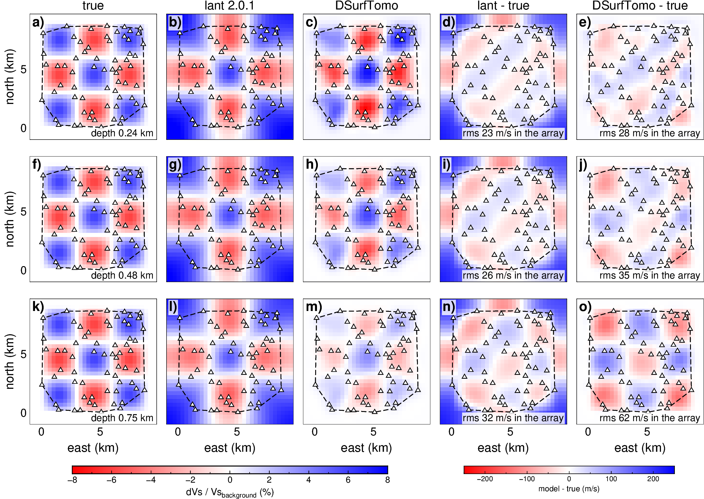
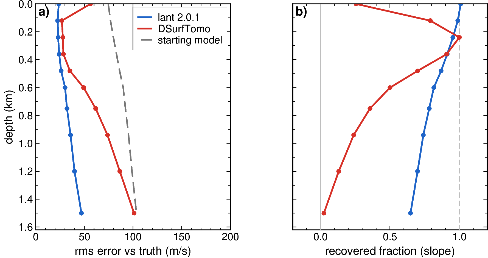
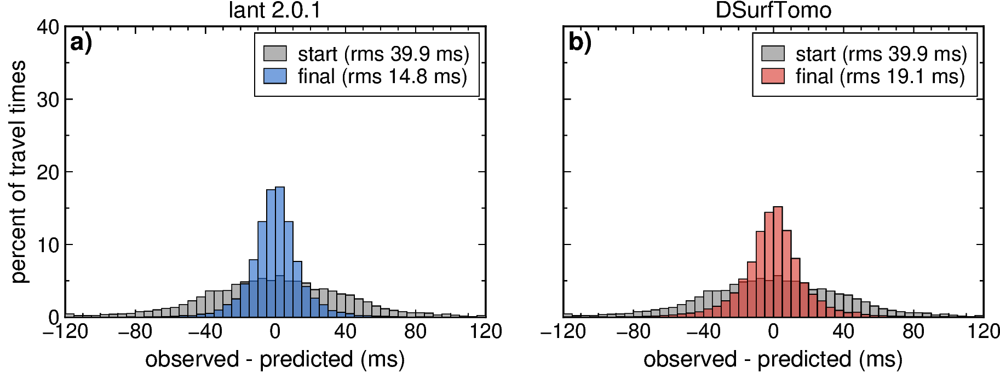
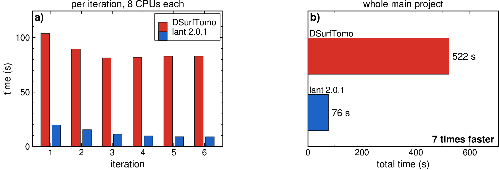
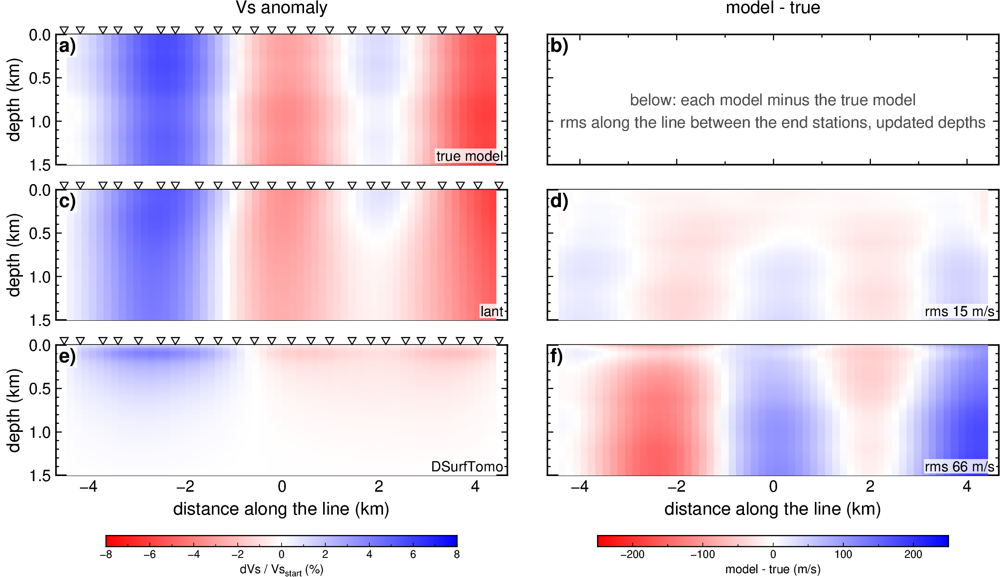
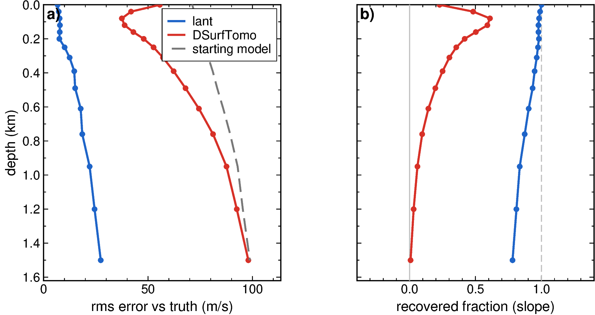
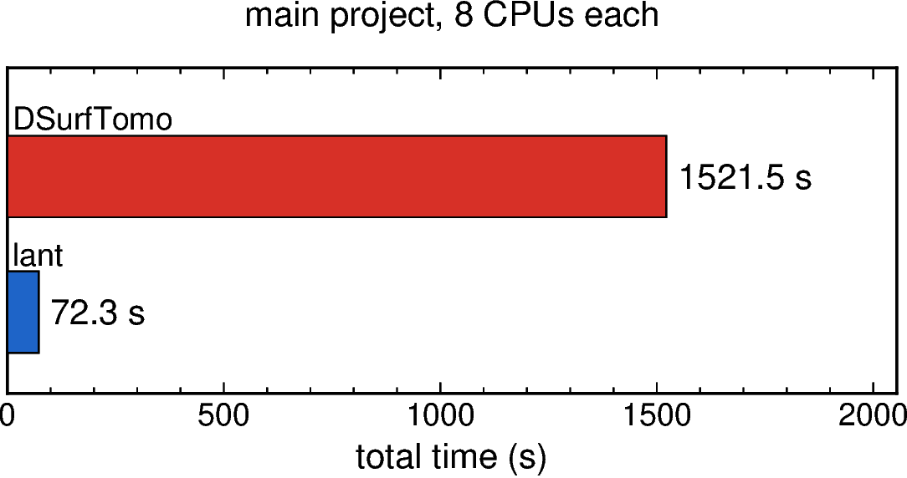

# Validation: synthetic tests at the inversion level

[中文](validation.zh.md) | English

Numbers only; what they mean for your data is yours to judge.

lant's accuracy is tested at the inversion level, the usual synthetic test of seismic tomography (Rawlinson & Spakman 2016): travel times of a known 3-D model are computed for a station layout, Gaussian noise is added, and the data are inverted, with lant and with the original DSurfTomo (a651faf, the program lant's 3-D inversion derives from), both compared with the true model. Such a test shows what the inversion recovers from the paths of the layout; it does not test the measurement of the dispersion (its basis and checks are in [methods.md](methods.md), section 7), nor the ray and local 1-D approximations both programs share. Read a real model together with its own checkerboard tests, which lant runs on the actual paths.

## 1. Test data

| | areal array | line |
|---|---|---|
| stations | 64 at random in a 9 km square, at least 0.4 km apart | 24 along a straight line at azimuth 60° across the square, up to 1 % of its length off it |
| true model | 1-D background (Vs 2.30 km/s at the surface to 3.40 km/s at 3 km) with a ±6 % sinusoidal checkerboard of 3-km cells inside the square, Vs₀(z)[1 + 0.06 sin(πx/3) sin(πy/3)] | the same |
| periods | 11, 0.21–1.19 s | 17, 0.074–1.19 s |
| travel times | 16 223 | 3 143 |

- Periods on lant's inversion grid (4 per octave through 1 Hz); every pair at least two wavelengths long at that period (`dispersion.qc.lam_c`).
- True travel times: DSurfTomo's forward (the fast marching and surfdisp96 both programs use) with the true model on its own depth nodes (0–3 km) and a grid of half the inversion's spacing, so that the data do not come from the inversion's own discretization (the "inverse crime", Rawlinson & Spakman 2016).
- Noise: Gaussian, standard deviation 2.5 % of the period in seconds (a phase error of 0.025 cycles; the residuals left by inverting dispersion that lant measured on synthetic waveforms were 1.2–3.5 % of the period), fixed seed; rms 13.4 ms on the areal data.
- The inversion project is built by lant's own rules from these data: average curve and 1-D starting model, depth nodes, velocity bounds, grid (median wavelength / 3) and inversion periods. All programs read the same `surfdata.dat`, `MOD` and `DSurfTomo.in` (checked by their hashes), with 6 iterations.
- Regularization and rejection are each program's own: lant weight 1 (its default; no damping) and rejection beyond 3 × 1.4826 MAD per period; DSurfTomo weight 1 and damping 1 (the damping commonly used with it) and its rejection outside 3 × the signed quartiles.
- Score: rms difference from the true model and regression slope of the recovered on the true anomaly (both relative to the starting model), on the nodes of the updated depths inside the stations' convex hull (areal array) or along the line between the end stations (line).
- Time: one run at a time, both pinned to the same 8 CPUs (`taskset`), lant `--threads 8`, DSurfTomo `OMP_NUM_THREADS=8`.

## 2. Areal array

| | rms error vs truth | recovered fraction | correlation | final residual rms; kept | time (8 CPUs) |
|---|---:|---:|---:|---:|---:|
| starting model | 88.5 m/s | | | 39.9 ms | |
| lant 2.0.1 | **31.4 m/s** | 0.82 | 0.94 | 14.8 ms; 99.6 % | **76 s** |
| DSurfTomo | 60.0 m/s | 0.44 | 0.75 | 19.1 ms; 88.0 % | 522 s |

- lant's error grows from 22–24 m/s above 0.4 km to 47 m/s at 1.5 km, the recovered fraction falls from 1.0 to 0.65; DSurfTomo recovers 0.8–1.0 between 0.12 and 0.36 km, 0.26 at the surface and less than 0.25 below 0.9 km (its damping holds each update towards zero, and the faces of its parameter box, the top layer included, are not smoothed).
- The final residual of lant (14.8 ms) is that of the added noise (13.4 ms). DSurfTomo's rejection on the signed quartiles drops 12 % of the data, which carry no outliers.
- Outside the array lant's model continues the anomalies of its edge (no data there; the smoothing alone sets it), DSurfTomo stays near the starting model; neither is constrained there.

## 3. Line

| | rms error vs truth | recovered fraction | correlation | final residual rms; kept | time (8 CPUs) |
|---|---:|---:|---:|---:|---:|
| starting model | 82.0 m/s | | | 25.2 ms | |
| lant 2.0.1 | **15.3 m/s** | 0.91 | 0.99 | 8.9 ms; 99.7 % | **72 s** |
| DSurfTomo | 65.5 m/s | 0.25 | 0.68 | 15.8 ms; 94.2 % | 1522 s |

- The truth and the models are compared on the line between its end stations (62 nodes along the line, 15 updated depths); the noise rms is 9.0 ms.
- lant's error grows from 7 m/s at the surface to 27 m/s at 1.5 km; DSurfTomo's from 37–56 m/s near the surface to 98 m/s, its recovered fraction at most 0.61 (0.08 km) and below 0.1 under 0.75 km.

## 4. Smoothing weight and damping on this test

**Weight against the number of travel times**: the first 16 and 32 of the 64 stations and all 64, the same model, periods and noise; lant at seven weights each (rms error vs truth inside the hull, m/s):

| stations; travel times | 0.2 | 0.35 | 0.5 | 0.7 | **1** | 1.4 | 2 |
|---|---:|---:|---:|---:|---:|---:|---:|
| 16; 948 | 32.3 | 26.0 | **25.1** | 25.8 | 29.6 | 35.2 | 46.4 |
| 32; 3 920 | 31.8 | **29.5** | 29.8 | 31.4 | 34.3 | 38.5 | 44.8 |
| 64; 16 223 | 25.7 | **24.5** | 25.2 | 27.5 | 31.4 | 36.1 | 42.5 |

The best weight stays at 0.35–0.5 while the number of travel times changes 17-fold: the data and model terms taken as means ([methods.md](methods.md), section 8.4) keep the weight's meaning. Its value depends on the errors of the data: on these data with independent Gaussian noise 0.35–0.5 recovers most; on dispersion measured from synthetic waveforms, whose errors also carry the measurement and the approximations of the synthesis, 1 did (smaller weights were clearly worse there). The default stays 1, the conservative value for real data; the controls `reg_x0.5` and `reg_x2` show how much a model depends on it.

**Damping** (rows d (m + dv − m0), as a mean over the parameters, in a test copy of the code), 64 stations; criteria set before the test: damping is kept only if it worsens the error inside the hull by at most 1 m/s and clearly holds the nodes no ray reaches (DWS = 0) at the starting model:

| weight; damping | 0 | 0.03 | 0.1 | 0.3 |
|---|---:|---:|---:|---:|
| 1: error inside the hull (m/s) | 31.4 | 31.4 | 34.0 | 48.1 |
| 1: departure of the nodes without rays from the starting model, rms / largest (m/s) | 136 / 221 | 111 / 181 | 43 / 89 | 7 / 27 |
| 0.5: error inside the hull (m/s) | 25.2 | 24.5 | 27.3 | 46.3 |
| 0.5: departure of the nodes without rays, rms / largest (m/s) | 118 / 215 | 74 / 143 | 21 / 60 | 3 / 17 |

Damping 0.1 holds the extrapolation to a third and worsens the model inside the array by 2–2.6 m/s; 0.03 leaves it unchanged and the extrapolation hardly (−19 % at weight 1). lant keeps no damping: where no ray passes, the model is the smooth continuation of its surroundings, not a result; `results/model/vs_model.csv` gives the DWS of every node (0: no data).

## 5. Other checks

**1-s periodic signal** (`clean`, [methods.md](methods.md) section 3): the fold F test at a significance of 0.1 %, on synthetic noise without any pulse:

| noise | sampling rate (Hz) | set A (20 records of 6 h each): 1.3.0 → 1.4.0 | set B (200 records each): 1.3.0 → 1.4.0 |
|---|---|---|---|
| white | 100 / 250 | 0 → 0 / 1 → 1 | 0 → 0 / 0 → 0 |
| red | 100 / 250 | 0 → 0 / 2 → 0 | 3 → 0 / 1 → 0 |
| microseism-like | 100 / 250 | 0 → 0 / 0 → 0 | 0 → 0 / 0 → 0 |
| band-limited | 100 / 250 | 0 → 0 / 3 → 0 | 2 → 0 / 14 → 0 |

For white noise the F test is exact; the one false detection in set A at 250 Hz is the same record in both versions. A pulse of 0.5 times the noise standard deviation once per second was detected in 200 of 200 records of set B.

**Inter-station distances**: on the WGS84 ellipsoid (Vincenty 1975). The ratio to the distance on a sphere of radius 6371 km depends on azimuth: at latitude 30° +0.30 % north–south and −0.18 % east–west; near the equator up to +0.56 % north–south. On 200 random pairs the relative difference to ObsPy `gps2dist_azimuth` is below 10⁻⁸ (`tests/test_numerics.py`).

**The chain runs**: on every change the continuous integration generates raw records (plane waves in a laterally uniform medium, mixed miniSEED and SAC, a station table without header) and runs the chain to the inversion project (`tests/smoke_records.py`); this checks that the steps run, not their accuracy.

## 6. Not tested

- The dispersion measurement against a known answer in a 3-D medium with full wave physics (finite-frequency effects, higher modes, directional noise); only the measurement's own derivations and unit tests cover it.
- Response removal on real data; moved nodes are covered by unit tests on constructed records only.
- SEG-2 input (it goes through the same reading path as SEG-Y); arrays of thousands of stations.
- Zone references (`reference.zone_km`) on a medium that needs them.

## References

- Rawlinson, N., & Spakman, W. (2016). On the use of sensitivity tests in seismic tomography. *Geophysical Journal International*, 205, 1221–1243. doi:10.1093/gji/ggw084
- Vincenty, T. (1975). Direct and inverse solutions of geodesics on the ellipsoid with application of nested equations. *Survey Review*, 23(176), 88–93.
