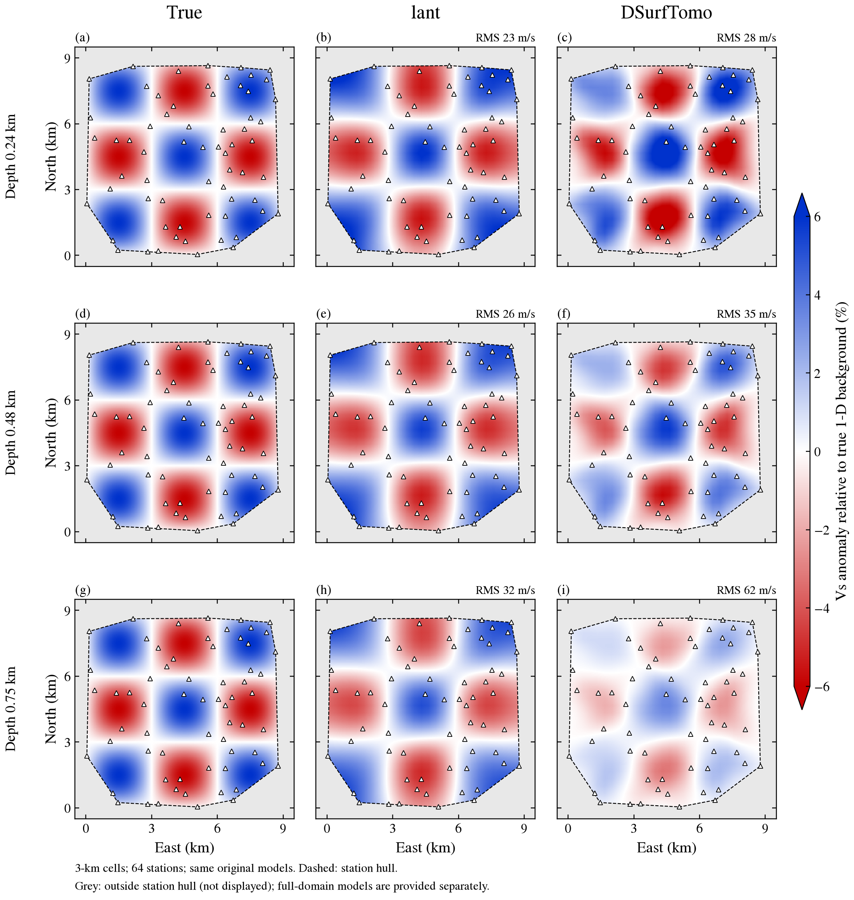
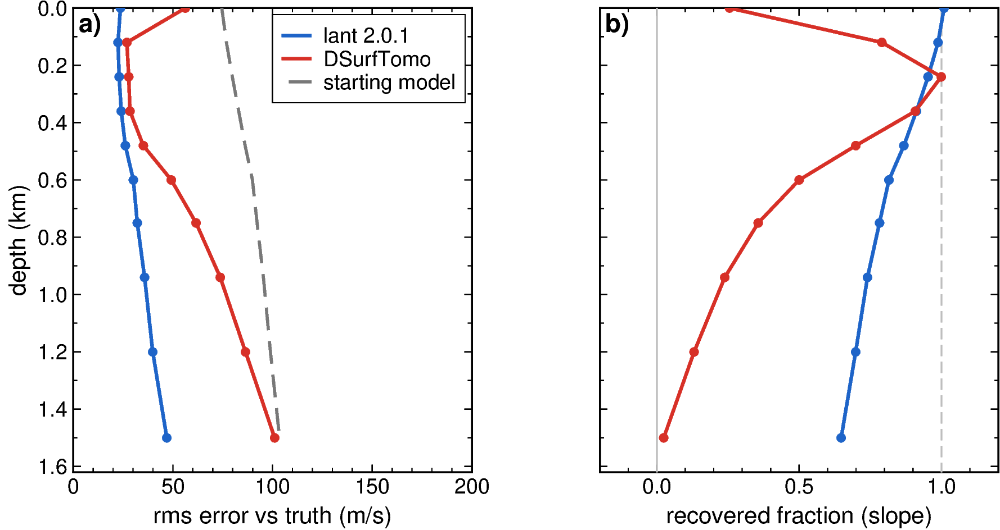
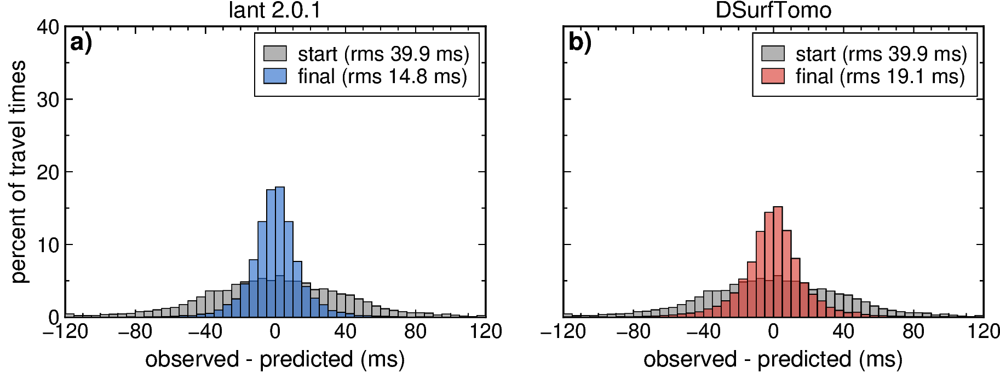
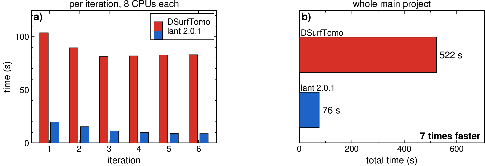
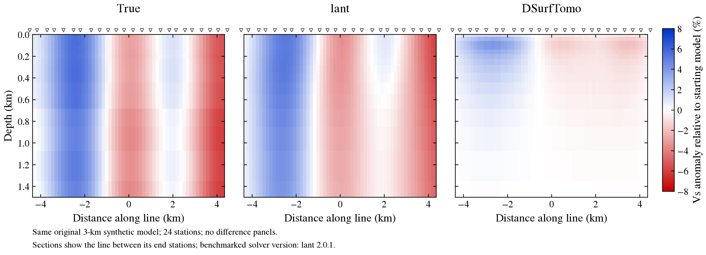
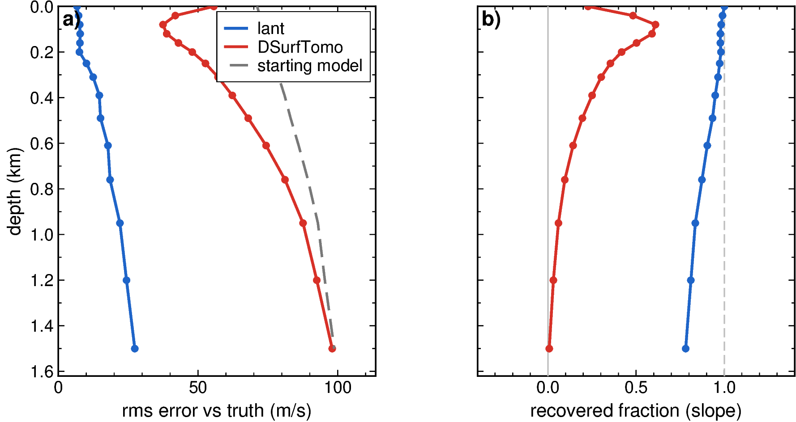
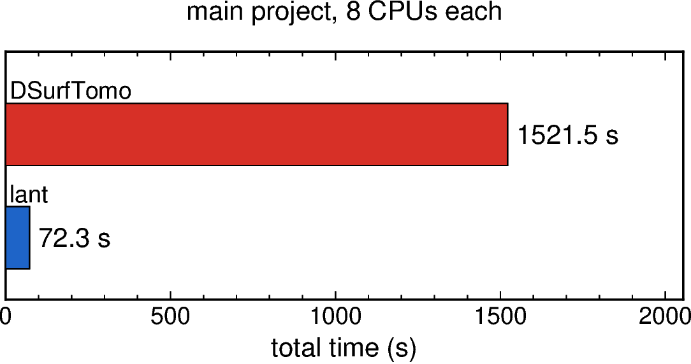

# 验证：反演层面的合成测试

中文 | [English](validation.md)

这里只给数字；它们对你的数据意味着什么由你判断。

lant 的精度在反演层面检验，即地震层析成像中常规的合成测试（Rawlinson & Spakman 2016）：给定台站布局，算出已知三维模型的走时，加高斯噪声，再分别用 lant 和原版 DSurfTomo（a651faf，lant 三维反演所源自的程序）反演，都与真实模型比较。这种测试显示反演能从该布局的路径中恢复多少；它不检验频散测量（其依据和检查见 [methods.zh.md](methods.zh.md) 第 7 节），也不检验两个程序共有的射线近似和局部一维近似。实际模型应与 lant 在实际路径上自动做的棋盘测试一起解读。

## 1. 测试数据

| | 面阵 | 测线 |
|---|---|---|
| 台站 | 64 个，随机分布在 9 km 见方的区域内，两两相距至少 0.4 km | 24 个，沿方位 60° 斜穿该区域的直线，偏离直线不超过线长的 1 % |
| 真实模型 | 一维背景（Vs 从地表 2.30 km/s 到 3 km 深 3.40 km/s）加区域内 ±6 % 的正弦棋盘，格子 3 km：Vs₀(z)[1 + 0.06 sin(πx/3) sin(πy/3)] | 同左 |
| 周期 | 11 个，0.21–1.19 s | 17 个，0.074–1.19 s |
| 走时 | 16 223 条 | 3 143 条 |

- 周期取 lant 反演所用的网格（过 1 Hz、每倍频程 4 个）；每个台对在该周期至少两个波长长（`dispersion.qc.lam_c`）。
- 真实走时：用 DSurfTomo 的正演（两个程序共用的快速行进法和 surfdisp96），真实模型放在它自己的深度节点上（0–3 km），网格间距取反演的一半，使数据不出自反演本身的离散化（即 inverse crime，Rawlinson & Spakman 2016）。
- 噪声：高斯，标准差为周期的 2.5 %（单位秒，相当于 0.025 周的相位误差；在合成波形上用 lant 测得的频散反演后，残差为周期的 1.2–3.5 %），随机种子固定；面阵数据上噪声均方根 13.4 ms。
- 反演工程按 lant 自己的规则由这些数据建立：平均曲线与一维起始模型、深度节点、速度上下限、网格（波长中位数 / 3）和反演周期。各程序读同一份 `surfdata.dat`、`MOD`、`DSurfTomo.in`（按哈希核对），都迭代 6 次。
- 正则化和剔除各用各的：lant 权重 1（默认值，不用阻尼），按周期剔除偏离超过 3 × 1.4826 MAD 的走时；DSurfTomo 权重 1、阻尼 1（它常用的阻尼），剔除带符号四分位数 3 倍以外的走时。
- 评分：与真实模型之差的均方根，以及反演异常对真实异常的回归斜率（都相对起始模型），取可更新深度上、台站凸包内（面阵）或测线两端台站之间（测线）的节点。
- 用时：一次只跑一个，两者都用 `taskset` 绑在同样的 8 个 CPU 上，lant `--threads 8`，DSurfTomo `OMP_NUM_THREADS=8`。

## 2. 面阵

原合成输入、细网格真模型和已保存的反演模型可从 [validation-3km-models.tar.gz](https://github.com/Shubin-Wei/local_ANT/releases/download/v2.0.2/validation-3km-models.tar.gz) 下载，内含逐文件校验和与重画说明。

`True` 是合成试验预先设定的真实模型，不是野外观测模型，也不是反演初始模型。这些图重画的是已保存的 lant 2.0.1 基准；2.0.2 仅改展示，不改变模型值或原 3 km 格宽。主图三列统一使用台站凸包显示掩膜和共同色标，不再绘制差值图；凸包本身不能证明可分辨性。

[未遮蔽的全域对比图](assets/compare_model_full_domain.png)保留真实计算出的凸包外异常，用斜线标出外部，并使用更宽的共同色标。[绘图来源与 DWS 诊断](assets/validation_figures.json)保存算例、格宽和输入哈希。可用 `python tools/plot_validation_comparison.py --root VALIDATION/compare_v201 --out docs/assets` 重画面阵与测线的三列图；命令不运行求解器。

| | 与真值的均方根误差 | 恢复比例 | 相关系数 | 最终残差均方根；保留比例 | 用时（8 CPU） |
|---|---:|---:|---:|---:|---:|
| 起始模型 | 88.5 m/s | | | 39.9 ms | |
| lant 2.0.1 | **31.4 m/s** | 0.82 | 0.94 | 14.8 ms；99.6 % | **76 s** |
| DSurfTomo | 60.0 m/s | 0.44 | 0.75 | 19.1 ms；88.0 % | 522 s |

- lant 的误差从 0.4 km 以浅的 22–24 m/s 增大到 1.5 km 的 47 m/s，恢复比例从 1.0 降到 0.65；DSurfTomo 在 0.12–0.36 km 恢复 0.8–1.0，地表 0.26，0.9 km 以下不到 0.25（它的阻尼把每轮更新量拉向零，参数盒子的表面——包括最浅一层——也不做平滑）。
- lant 的最终残差（14.8 ms）就是所加噪声的大小（13.4 ms）。DSurfTomo 按带符号四分位数剔除，去掉了 12 % 的数据，而这些数据里并没有异常值。
- 台站凸包外的数据敏感度稀疏，尚不能证明可分辨性。在 0.24/0.48/0.75 km 深度，每层 509 个凸包外节点中分别有 317/324/330 个节点的残差剔除后 DWS 为 0；其余部分节点虽有非零 DWS，也不等于结构可被分辨。lant 没有向起始模型的阻尼约束，平滑可能把边缘异常延伸到外部；0.24 km 的外部正异常达到 +9.02%，超过真模型的 +6%。这些是外推伪影，不能当作恢复出的结构。本次没有为了去掉这些颜色而修改反演或模型值。

## 3. 测线

| | 与真值的均方根误差 | 恢复比例 | 相关系数 | 最终残差均方根；保留比例 | 用时（8 CPU） |
|---|---:|---:|---:|---:|---:|
| 起始模型 | 82.0 m/s | | | 25.2 ms | |
| lant 2.0.1 | **15.3 m/s** | 0.91 | 0.99 | 8.9 ms；99.7 % | **72 s** |
| DSurfTomo | 65.5 m/s | 0.25 | 0.68 | 15.8 ms；94.2 % | 1522 s |

- 真值与各模型在测线两端台站之间比较（沿线 62 个节点、15 个可更新深度）；噪声均方根 9.0 ms。
- lant 的误差从地表的 7 m/s 增大到 1.5 km 的 27 m/s；DSurfTomo 从近地表的 37–56 m/s 增大到 98 m/s，恢复比例最高 0.61（0.08 km），0.75 km 以下不到 0.1。

## 4. 这个测试上的平滑权重和阻尼

**权重与走时条数**：取 64 个台站中的前 16 个、前 32 个和全部 64 个，模型、周期、噪声都相同，lant 各试七个权重（凸包内与真值的均方根误差，m/s）：

| 台站；走时 | 0.2 | 0.35 | 0.5 | 0.7 | **1** | 1.4 | 2 |
|---|---:|---:|---:|---:|---:|---:|---:|
| 16；948 | 32.3 | 26.0 | **25.1** | 25.8 | 29.6 | 35.2 | 46.4 |
| 32；3 920 | 31.8 | **29.5** | 29.8 | 31.4 | 34.3 | 38.5 | 44.8 |
| 64；16 223 | 25.7 | **24.5** | 25.2 | 27.5 | 31.4 | 36.1 | 42.5 |

走时条数变了 17 倍，最优权重一直在 0.35–0.5：数据项和模型项取均值（[methods.zh.md](methods.zh.md) 第 8.4 节）使权重的含义保持不变。它的数值取决于数据误差：在这些只含独立高斯噪声的数据上，0.35–0.5 恢复得最多；在从合成波形测得的频散上（误差还包含测量环节和合成近似的误差），1 恢复得最多，更小的权重明显更差。默认值仍为 1，对实际数据是偏保守的取值；对照 `reg_x0.5` 和 `reg_x2` 显示模型对它的依赖程度。

**阻尼**（行 d (m + dv − m0)，按参数个数取均值，在代码的测试副本中），64 台；判据在检验前定好：只有当阻尼使凸包内误差变差不超过 1 m/s，并明显把没有射线经过的节点（DWS = 0）留在起始模型时，才保留：

| 权重；阻尼 | 0 | 0.03 | 0.1 | 0.3 |
|---|---:|---:|---:|---:|
| 1：凸包内误差（m/s） | 31.4 | 31.4 | 34.0 | 48.1 |
| 1：无射线节点偏离起始模型，均方根 / 最大（m/s） | 136 / 221 | 111 / 181 | 43 / 89 | 7 / 27 |
| 0.5：凸包内误差（m/s） | 25.2 | 24.5 | 27.3 | 46.3 |
| 0.5：无射线节点的偏离，均方根 / 最大（m/s） | 118 / 215 | 74 / 143 | 21 / 60 | 3 / 17 |

阻尼 0.1 把外推压到三分之一，但台阵内的模型变差 2–2.6 m/s；0.03 不改变台阵内，外推也几乎不变（权重 1 时 −19 %）。lant 不用阻尼：没有射线经过的地方，模型是周围的平滑延续，不是结果；`results/model/vs_model.csv` 给出每个节点的 DWS（0 表示没有数据）。

## 5. 其他检查

**1 s 周期信号**（`clean`，[methods.zh.md](methods.zh.md) 第 3 节）：折叠 F 检验，显著性 0.1 %，在没有脉冲的合成噪声上：

| 噪声 | 采样率（Hz） | A 组（每种 20 个 6 小时记录）：1.3.0 → 1.4.0 | B 组（每种 200 个记录）：1.3.0 → 1.4.0 |
|---|---|---|---|
| 白噪声 | 100 / 250 | 0 → 0 / 1 → 1 | 0 → 0 / 0 → 0 |
| 红噪声 | 100 / 250 | 0 → 0 / 2 → 0 | 3 → 0 / 1 → 0 |
| 微震型 | 100 / 250 | 0 → 0 / 0 → 0 | 0 → 0 / 0 → 0 |
| 带限噪声 | 100 / 250 | 0 → 0 / 3 → 0 | 2 → 0 / 14 → 0 |

白噪声的 F 检验是精确的；A 组 250 Hz 那一次误报在两个版本中是同一个记录。每秒一个幅度为 0.5 倍噪声标准差的脉冲：B 组 200/200 检出。

**台间距离**：按 WGS84 椭球计算（Vincenty 1975）。与半径 6371 km 的球面距离之比随方位变化：纬度 30° 处南北向 +0.30 %、东西向 −0.18 %；赤道附近南北向可达 +0.56 %。与 ObsPy `gps2dist_azimuth` 在 200 个随机台对上的相对差小于 10⁻⁸（`tests/test_numerics.py`）。

**流程能否跑通**：每次改动，持续集成都会生成原始记录（横向均匀介质中的平面波，miniSEED 与 SAC 混合，台站表无表头），并把流程跑到反演工程（`tests/smoke_records.py`）；这只检查各步骤能运行，不检查精度。

## 6. 没有检验的内容

- 在含完整波动物理（有限频效应、高阶模式、方向性噪声）的三维介质中，用已知答案检验频散测量；这一环只有测量本身的推导和单元测试覆盖。
- 实测数据上的去仪器响应；节点搬站只有构造记录上的单元测试。
- SEG-2 输入（与 SEG-Y 走同一条读取路径）；上千台的台阵。
- 需要分区参考（`reference.zone_km`）的介质上的分区参考。

## 参考文献

- Rawlinson, N., & Spakman, W. (2016). On the use of sensitivity tests in seismic tomography. *Geophysical Journal International*, 205, 1221–1243. doi:10.1093/gji/ggw084
- Vincenty, T. (1975). Direct and inverse solutions of geodesics on the ellipsoid with application of nested equations. *Survey Review*, 23(176), 88–93.
