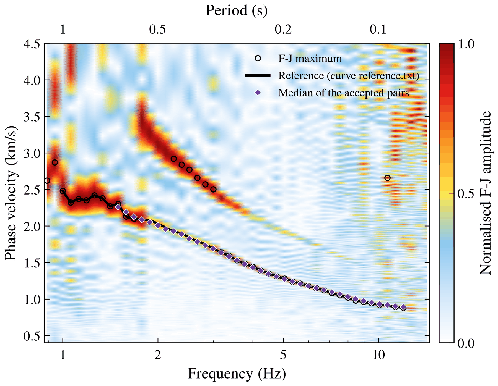
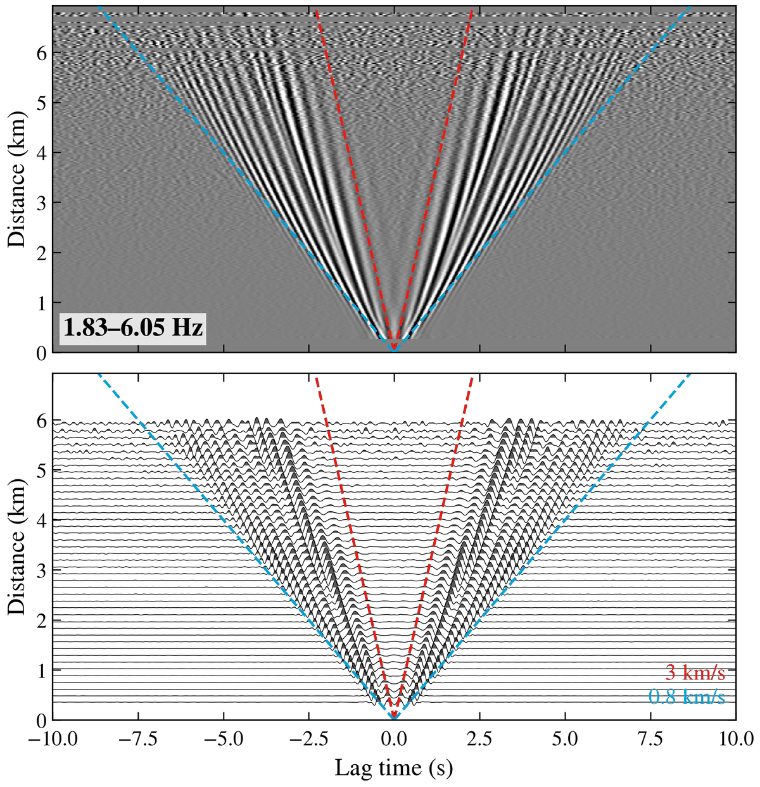
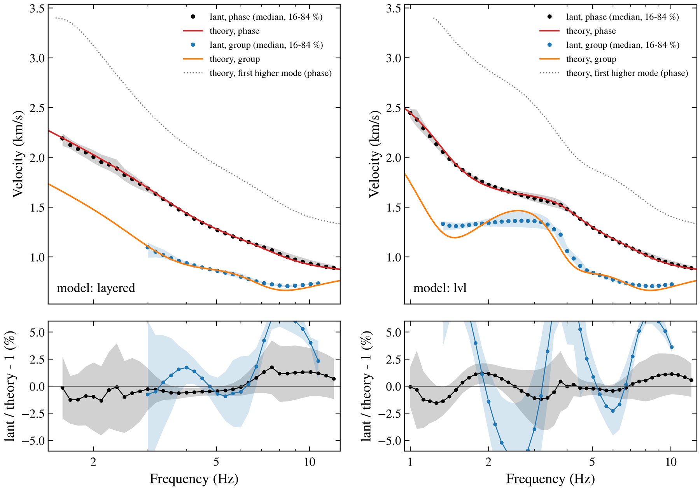
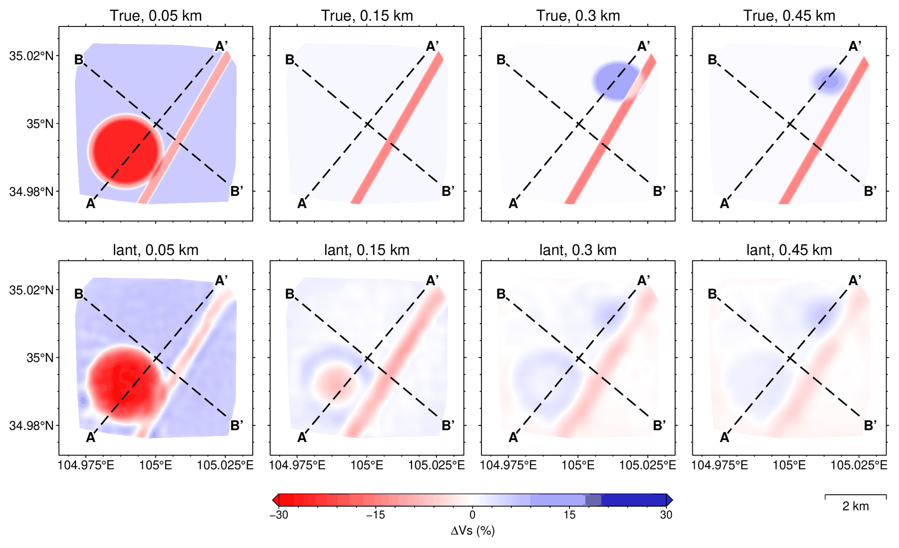
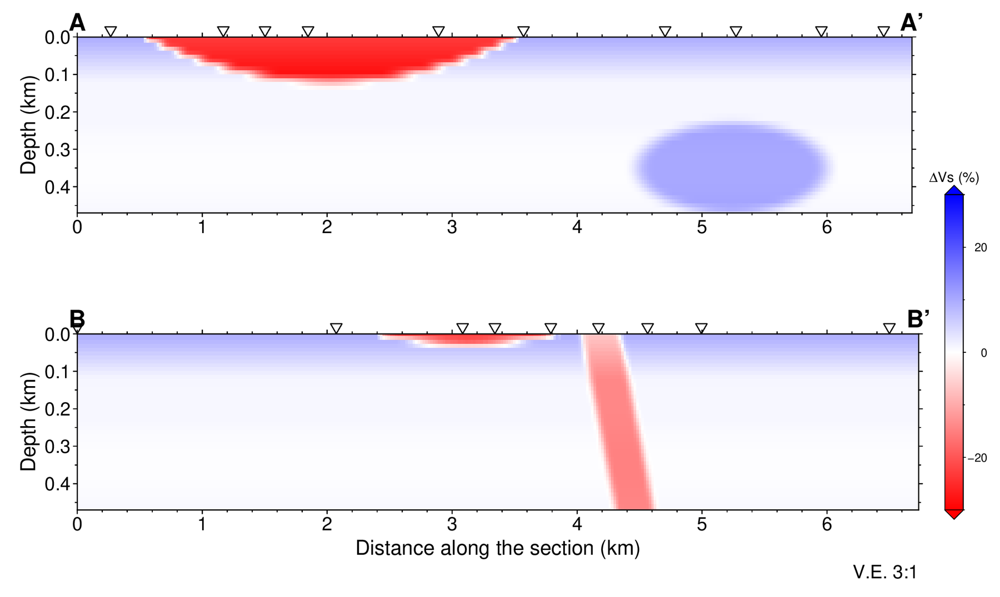
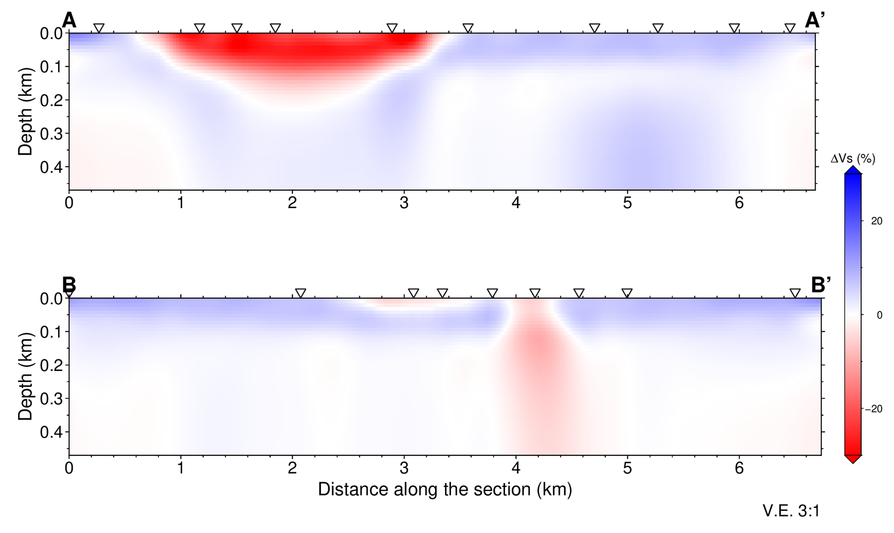
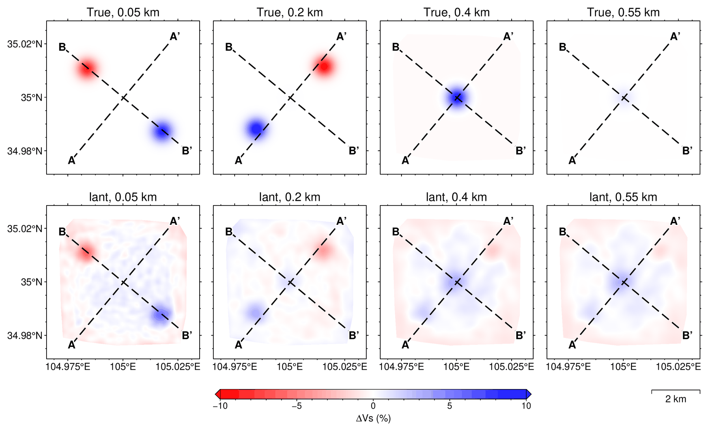
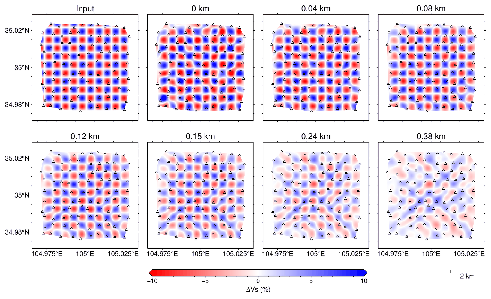

# Synthetic example

[中文](README.zh.md) | English

Data made from known models, run through lant, and compared with the truth. The example has two parts, as synthetic tests usually do:

- **A. Measurement**: continuous noise records over two 1-D models, through `lant clean`, `cc` and `disp`; the measured phase and group velocities are compared with the theoretical dispersion of the models.
- **B. Inversion**: phase travel times through a 3-D model, along the paths and at the periods measured in part A, inverted with `lant inv`; the recovered model is compared with the true one. A spike test and `lant checker` show the resolution.

The data are not in the repository; the scripts here make them (about 1.7 GB per model).

## Files

| File | Content |
|---|---|
| `models.txt` | the two 1-D models (`layered`, `lvl`) |
| `modes.py`, `modes_<model>.csv` | Rayleigh modes of the models (phase and group velocity, excitation), computed with Computer Programs in Seismology (Herrmann 2013); `modes.py` remakes the tables if CPS is installed |
| `make_waveforms.py` | part A: the noise records |
| `pick_reference.py`, `reference_<model>.txt` | the reference curves picked along the F-J spectrum (see below) |
| `make_3d_data.py` | part B: the 3-D model and its travel times |
| `compare.py` | the figures below |

## A. Measurement

**Data.** 100 stations, 10 × 10 nodes 0.55 km apart, each moved at random by up to 0.18 km (about 5 × 5 km; one station without records). One day at 50 Hz. Point sources with white random source time functions, uniformly over a disk three times the array radius, inside the array too (not within 25 m of a station), 60 new sources every 100 s, as in Herrmann's CPS tutorial on high-frequency noise. Each source gives every station the sum of the Rayleigh modes of the model (fundamental and higher modes with their excitation, Hankel function of the distance) with attenuation Q = 50. On top: independent noise at every station (half the rms of the wavefield), six 2 s glitches of 50 times the rms, two gaps.

| Model | Vs from the surface down (km/s; layer thickness in km) |
|---|---|
| `layered` | 0.90 (0.05), 1.40 (0.10), 2.00 (0.15), 2.50 (0.25), 2.85 (0.40), 3.15 (0.60), 3.40 |
| `lvl` | 0.90 (0.05), 1.40 (0.10), 2.20 (0.15), **1.70 (0.20)**, 2.85 (0.40), 3.15 (0.60), 3.40 |

**Run** (here for `layered`; `DATA` is any folder, e.g. `data/`; about 16 min on 16 cores for the records, 2 min for clean, cc and disp):

```bash
cd examples/synthetic
python make_waveforms.py layered DATA/layered --cores 8
lant init -o DATA/layered/config.yaml --raw DATA/layered/raw --stations DATA/layered/stations.txt \
          --out DATA/layered/output --velocity 0.8 3.0
# in config.yaml: plots.relief: null (the coordinates are made up)
lant clean -c DATA/layered/config.yaml
lant cc    -c DATA/layered/config.yaml
lant disp  -c DATA/layered/config.yaml
```

**The reference curve.** In `3_disp/figures/fj_reference.png` the strongest ridge between 2 and 3 Hz (`lvl`: 2.7–4 Hz) is the first higher mode, above the fundamental; the F-J picks jump to it and the reference there is up to 19 % too fast. As the tutorial says, the reference must follow the fundamental mode, the slowest ridge. We picked it along the slowest ridge with `pick_reference.py` and the points read by eye from the figure:

```bash
python pick_reference.py DATA/layered/output/3_disp/fj.h5 reference_layered.txt \
       0.9,2.55 1.2,2.38 1.5,2.27 1.8,2.12 2.0,2.02 2.5,1.85 3.0,1.69 4.0,1.45 5.0,1.29 7.0,1.09 10.0,0.93 13.0,0.88
# lvl: 0.9,2.4 1.0,2.3 1.3,2.12 1.6,1.9 2.0,1.72 2.5,1.65 3.0,1.6 4.0,1.52 5.0,1.32 7.0,1.1 10.0,0.93 13.0,0.88
```

then set `disp.reference: file`, `disp.reference_file: reference_layered.txt` (a path relative to the configuration) and run `lant disp` again.



*F-J spectrum of `layered` with the reference picked along the fundamental mode (black) and the median of the measured phase velocities (diamonds). The ridge above it between 2 and 3 Hz is the first higher mode.*



*Correlations of `layered` against distance, 1.83–6.05 Hz (`2_cc/figures`).*

**Result.**



*Median and 16–84 % range of the accepted phase (black) and group (blue) velocities at each frequency, and the theoretical fundamental mode (lines). Below: deviation from the theory.*

| Model | Phase velocity | Group velocity |
|---|---|---|
| `layered` | 1.6–12 Hz: median deviation −0.3 %, all within 1.7 % | 3–10.7 Hz: median +1.4 %, up to +6.9 % near the minimum of the group velocity (8–9 Hz) |
| `lvl` | 1.0–12 Hz: median −0.1 %, all within 1.6 % | 4.5–6.5 Hz within 2.5 %, up to +6 % near the minimum (8–9 Hz); 1.3–4 Hz up to 13 %: the theoretical group velocity changes faster there than the Gaussian filters (α = 5) resolve |

## B. Inversion

**True model.** The `layered` model with, in the upper 0.6 km that the data resolve (about half the longest wavelength):

- a sedimentary basin, a bowl 1.5 km in radius and 0.12 km deep, Vs 30 % lower;
- a fault zone 0.3 km wide, striking N30°E, dipping 60° to the south-east, down to 0.6 km, Vs 15 % lower;
- a buried body at 0.35 km depth (1.8 × 1.4 × 0.24 km), Vs 10 % higher.

The spike test (`--model spikes`) has five isolated anomalies of ±10 % at 0.05, 0.2 and 0.4 km.

**Data.** For every pair and period of part A, the travel time through the true model: surfdisp96 on every column and fast-marching ray tracing (lant's forward calculation) on a grid twice as fine as the inversion grid, plus Gaussian noise with the jackknife error of the measurement in part A, as in the synthetic tests of Fang et al. (2015) and Rawlinson & Spakman (2016).

```bash
python make_3d_data.py DATA/layered/config.yaml DATA/structures            # 1 min
lant inv -c DATA/structures/config.yaml                                     # 6 min on 16 cores
python compare.py model figures/structures DATA/structures
python make_3d_data.py DATA/layered/config.yaml DATA/spikes --model spikes
lant inv -c DATA/spikes/config.yaml
python compare.py model figures/spikes DATA/spikes 0.05,0.2,0.4,0.55
lant checker -c DATA/layered/config.yaml --size 0.5                         # on the inversion of part A
```

lant inv derives everything itself (starting model from the average curve, depth nodes, grid); nothing of the true model is given to it.

**Result.** Vs perturbation from the mean of each depth, true (above) and recovered (below):



| True | Recovered |
|---|---|
|  |  |

Correlation of the recovered with the true perturbation at the inversion nodes: 0.90–0.96 down to 0.08 km, 0.65–0.81 at 0.1–0.3 km, 0.49 at 0.47 km; the recovered amplitude falls from 80–92 % near the surface to 35 % at 0.3 km and 25 % at 0.47 km (`figures/structures_recovery.csv`). The basin and the fault zone are recovered where they are; the bottom of the basin is smeared down by about 0.1 km, and the buried body appears with about half its amplitude and extends deeper than it is.





*`lant checker --size 0.5`: correlation 0.88–0.93 down to 0.15 km, 0.53 at 0.47 km; with 1 km cells 0.83 at 0.59 km.*

## What this example does and does not show

- Part A is the test of the measurement: the records are made with modal summation of CPS's modes, independently of lant's processing, and the theory is exact.
- Part B uses lant's own forward calculation to make the data. A finer grid and noise reduce the "inverse crime" but do not remove it: the true model is still seen through the same ray and 1-D-column approximations. Part B shows what the data coverage and the regularisation can resolve, not the accuracy of those approximations.
- Surface waves see a smoothed version of the layers: the 1-D inversions of part A return the layered models as gradients, and the low-velocity layer of `lvl` is not recovered.
