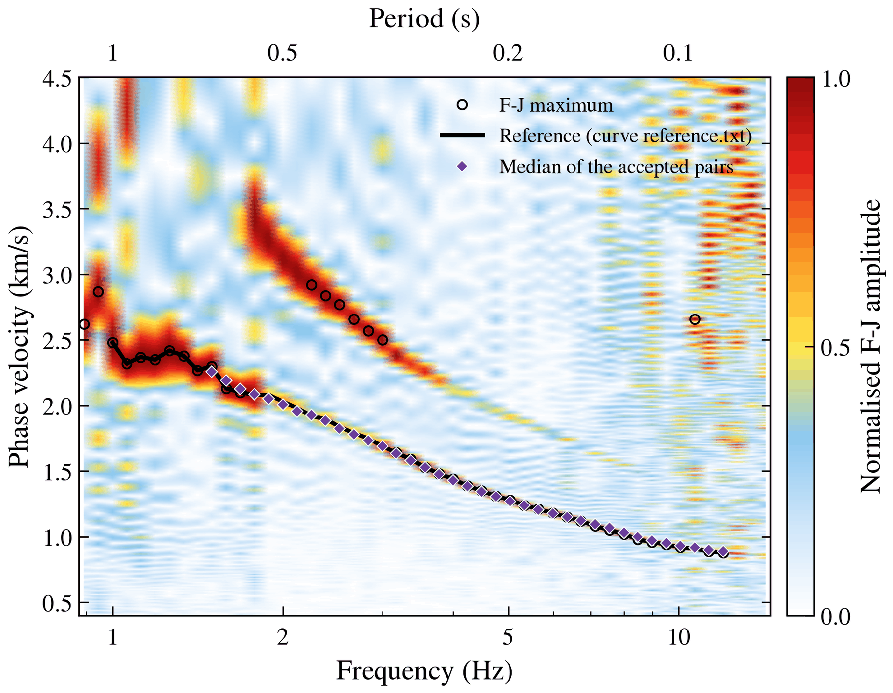
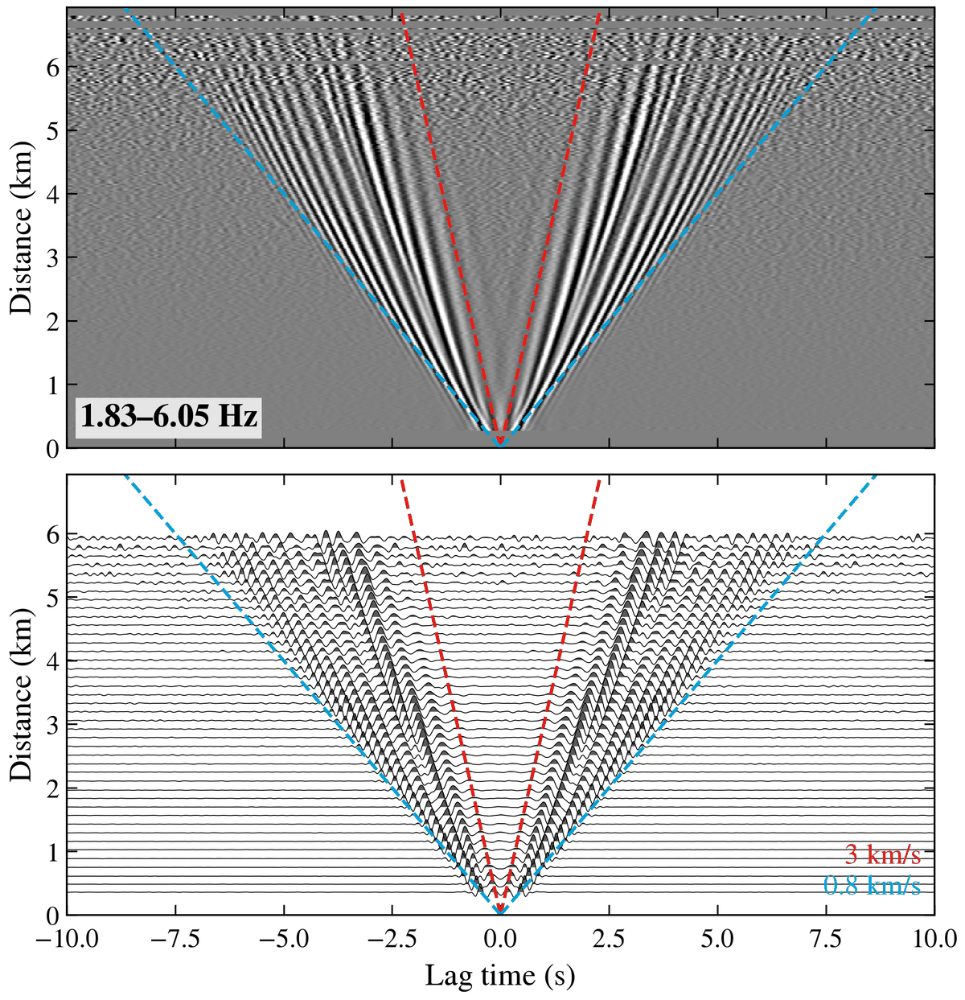
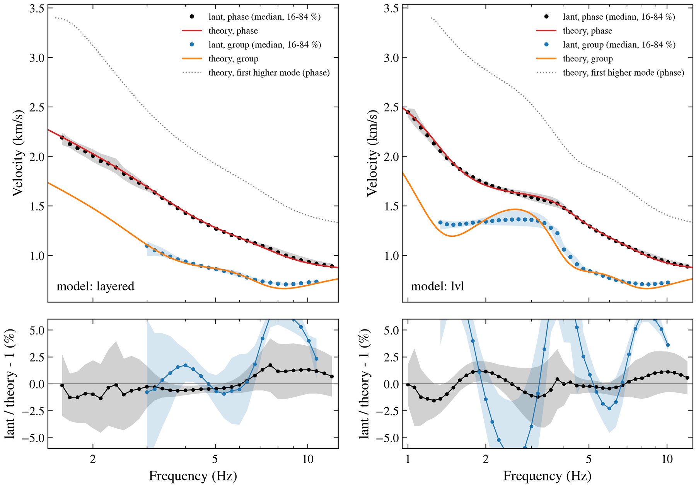
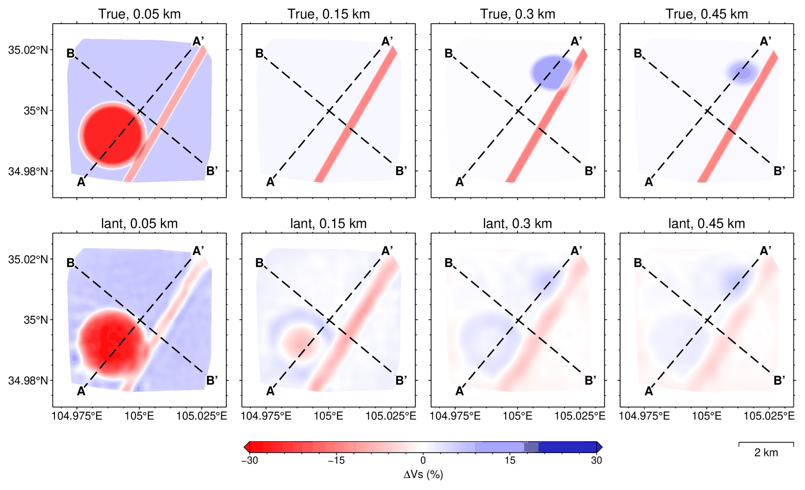
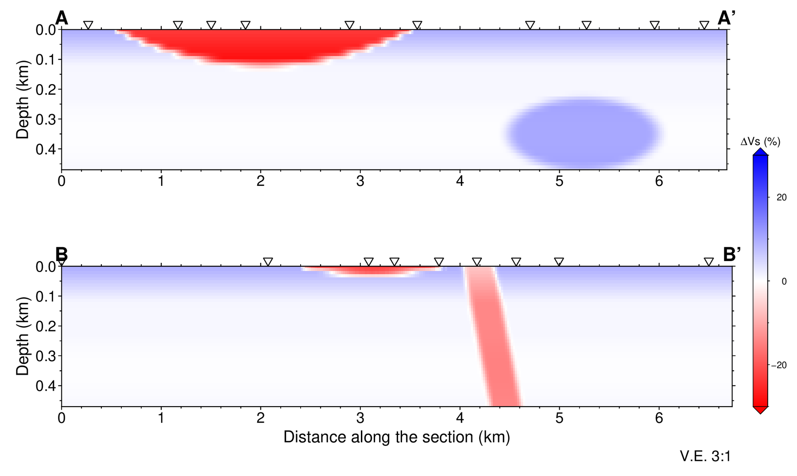
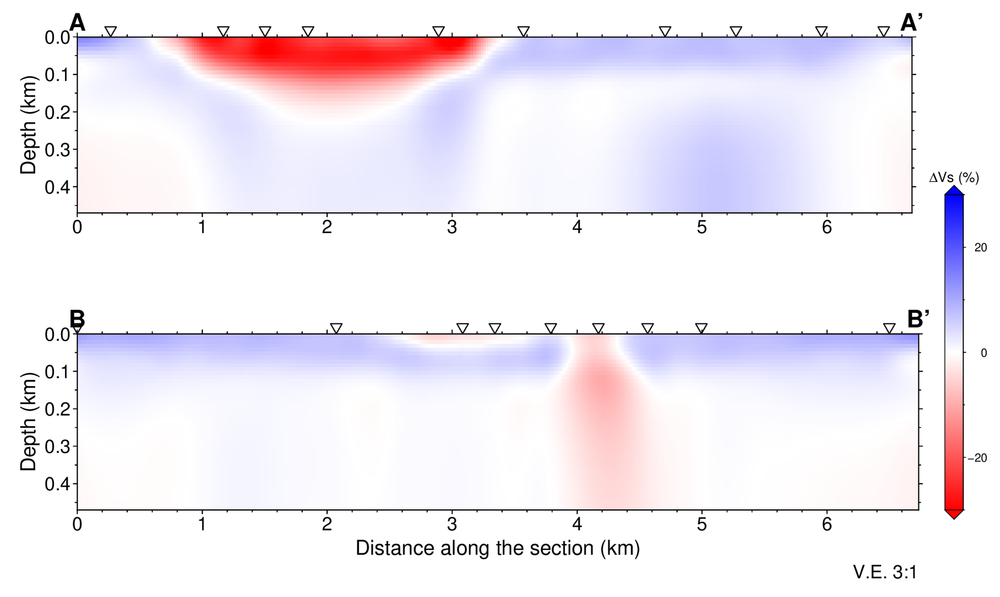
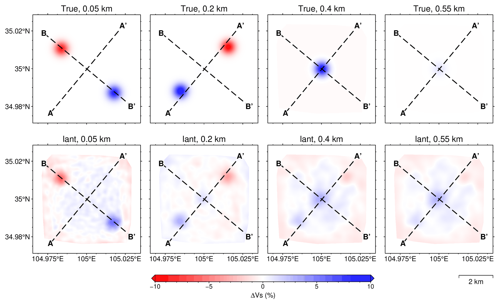
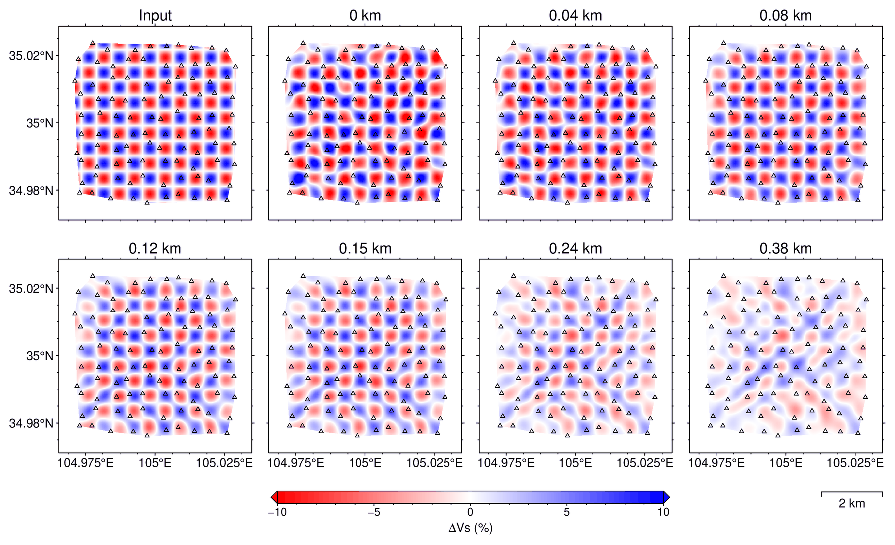

# 合成数据示例

中文 | [English](README.md)

用已知模型生成数据，经过 lant 处理，再与真实模型对比。按合成检验的常见做法分两部分：

- **A. 测量**：在两个一维模型上合成连续噪声记录，经 `lant clean`、`cc`、`disp`，把测得的相速度和群速度与模型的理论频散比较。
- **B. 反演**：沿 A 中实际测到的台对和周期，计算三维模型中的相速度走时，用 `lant inv` 反演，与真实模型比较；另做尖峰检验和 `lant checker` 看分辨率。

数据不放在仓库里，用这里的脚本生成（每个模型约 1.7 GB）。

## 文件

| 文件 | 内容 |
|---|---|
| `models.txt` | 两个一维模型（`layered`、`lvl`） |
| `modes.py`、`modes_<模型>.csv` | 模型的 Rayleigh 波各阶模式（相速度、群速度、激发振幅），用 Computer Programs in Seismology（Herrmann 2013）计算；装有 CPS 时 `modes.py` 可重算这些表 |
| `make_waveforms.py` | A：噪声记录 |
| `pick_reference.py`、`reference_<模型>.txt` | 沿 F-J 谱拾取的参考曲线（见下文） |
| `make_3d_data.py` | B：三维模型及其走时 |
| `compare.py` | 下面的对比图 |

## A. 测量

**数据**：100 个台站，10 × 10 个节点，间距 0.55 km，每个随机移动不超过 0.18 km（约 5 × 5 km；其中一台没有记录）。一天，采样率 50 Hz。点源的震源时间函数是白噪声，均匀分布在半径为台阵半径 3 倍的圆内，台阵内部也有（不在台站 25 m 以内），每 100 s 换 60 个新源，做法同 Herrmann 的 CPS 高频噪声教程。每个源到每个台站的记录是模型各阶 Rayleigh 波模式之和（基阶和高阶，按各自的激发振幅，距离用 Hankel 函数），衰减 Q = 50。另外每个台加上独立噪声（波场均方根的一半）、六个 2 s 长、50 倍均方根的突跳，以及两段缺数。

| 模型 | 自地表向下的 Vs（km/s；括号内为层厚 km） |
|---|---|
| `layered` | 0.90 (0.05)、1.40 (0.10)、2.00 (0.15)、2.50 (0.25)、2.85 (0.40)、3.15 (0.60)、3.40 |
| `lvl` | 0.90 (0.05)、1.40 (0.10)、2.20 (0.15)、**1.70 (0.20)**、2.85 (0.40)、3.15 (0.60)、3.40 |

**运行**（以 `layered` 为例；`DATA` 为任意目录，如 `data/`；16 核上生成记录约 16 分钟，clean、cc、disp 共约 2 分钟）：

```bash
cd examples/synthetic
python make_waveforms.py layered DATA/layered --cores 8
lant init -o DATA/layered/config.yaml --raw DATA/layered/raw --stations DATA/layered/stations.txt \
          --out DATA/layered/output --velocity 0.8 3.0
# config.yaml 里设 plots.relief: null（坐标是虚构的）
lant clean -c DATA/layered/config.yaml
lant cc    -c DATA/layered/config.yaml
lant disp  -c DATA/layered/config.yaml
```

**参考曲线**：`3_disp/figures/fj_reference.png` 上，2–3 Hz（`lvl` 为 2.7–4 Hz）最强的脊是第一高阶模式，在基阶上方；F-J 拾取跳到了它上面，参考曲线在这一段偏快最多 19 %。按教程的要求，参考曲线必须沿基阶，也就是最慢的那条脊。我们用 `pick_reference.py` 沿最慢的脊拾取，所用的点是从图上目测的：

```bash
python pick_reference.py DATA/layered/output/3_disp/fj.h5 reference_layered.txt \
       0.9,2.55 1.2,2.38 1.5,2.27 1.8,2.12 2.0,2.02 2.5,1.85 3.0,1.69 4.0,1.45 5.0,1.29 7.0,1.09 10.0,0.93 13.0,0.88
# lvl: 0.9,2.4 1.0,2.3 1.3,2.12 1.6,1.9 2.0,1.72 2.5,1.65 3.0,1.6 4.0,1.52 5.0,1.32 7.0,1.1 10.0,0.93 13.0,0.88
```

然后设 `disp.reference: file`、`disp.reference_file: reference_layered.txt`（相对配置文件的路径），再运行一次 `lant disp`。



*`layered` 的 F-J 谱，黑线为沿基阶拾取的参考曲线，菱形为实测相速度的中位数。2–3 Hz 上方的那条脊是第一高阶模式。*



*`layered` 的互相关随台距排列，1.83–6.05 Hz（`2_cc/figures`）。*

**结果**：



*每个频率接受的相速度（黑）和群速度（蓝）的中位数及 16–84 % 范围，线为理论基阶。下图为相对理论值的偏差。*

| 模型 | 相速度 | 群速度 |
|---|---|---|
| `layered` | 1.6–12 Hz：中位偏差 −0.3 %，全部在 1.7 % 以内 | 3–10.7 Hz：中位 +1.4 %，群速度极小值附近（8–9 Hz）最多 +6.9 % |
| `lvl` | 1.0–12 Hz：中位 −0.1 %，全部在 1.6 % 以内 | 4.5–6.5 Hz 在 2.5 % 以内，极小值附近（8–9 Hz）最多 +6 %；1.3–4 Hz 最多 13 %：这一段理论群速度变化太快，高斯滤波器（α = 5）分辨不了 |

## B. 反演

**真实模型**：`layered` 模型，在数据能分辨的上部 0.6 km（约为最长波长的一半）内加入：

- 沉积盆地：碗状，半径 1.5 km、中心深 0.12 km，Vs 低 30 %；
- 断裂带：宽 0.3 km，走向 N30°E，向南东倾 60°，深至 0.6 km，Vs 低 15 %；
- 隐伏体：中心深 0.35 km（1.8 × 1.4 × 0.24 km），Vs 高 10 %。

尖峰检验（`--model spikes`）在 0.05、0.2、0.4 km 深处放五个孤立的 ±10 % 异常。

**数据**：A 中每个台对、每个周期的真实模型走时：每个柱子用 surfdisp96 算频散，再用快速推进法追踪射线（lant 的正演），网格比反演网格细一倍；再按 A 中该测量的刀切误差加高斯噪声，做法同 Fang et al. (2015) 和 Rawlinson & Spakman (2016) 的合成检验。

```bash
python make_3d_data.py DATA/layered/config.yaml DATA/structures            # 1 分钟
lant inv -c DATA/structures/config.yaml                                     # 16 核 6 分钟
python compare.py model figures/structures DATA/structures
python make_3d_data.py DATA/layered/config.yaml DATA/spikes --model spikes
lant inv -c DATA/spikes/config.yaml
python compare.py model figures/spikes DATA/spikes 0.05,0.2,0.4,0.55
lant checker -c DATA/layered/config.yaml --size 0.5                         # 用 A 的反演
```

lant inv 的起始模型、深度节点、网格都由它自己从数据推出，不给它任何真实模型的信息。

**结果**：相对同一深度平均值的 Vs 扰动，上为真实模型，下为反演结果：



| 真实 | 恢复 |
|---|---|
|  |  |

反演节点上恢复扰动与真实扰动的相关系数：0.08 km 以浅为 0.90–0.96，0.1–0.3 km 为 0.65–0.81，0.47 km 为 0.49；恢复幅度从近地表的 80–92 % 降到 0.3 km 的 35 % 和 0.47 km 的 25 %（`figures/structures_recovery.csv`）。盆地和断裂带都恢复在原来的位置；盆地底部向下拖尾约 0.1 km，隐伏体只恢复了约一半的幅度，而且比实际延伸得更深。





*`lant checker --size 0.5`：0.15 km 以浅相关系数 0.88–0.93，0.47 km 为 0.53；1 km 格子在 0.59 km 处为 0.83。*

## 这个示例说明了什么、没说明什么

- A 检验的是测量：记录由 CPS 各阶模式叠加合成，与 lant 的处理互不相干，理论值是精确的。
- B 用 lant 自己的正演生成数据。加细网格和噪声能减轻“反演犯罪”（inverse crime），但不能消除：真实模型仍是通过同样的射线和一维柱子近似看到的。B 说明的是数据覆盖和正则化能分辨什么，不是这些近似本身准不准。
- 面波看到的是层状结构的平滑形态：A 的一维反演把层状模型反演成渐变，`lvl` 的低速层没有反演出来。
